# LyonPanel — Architecture

Statut : **validé par le propriétaire le 2026-11-07**. « (mon choix) » = décidé par Claude, à vérifier.
Règle pour tout agent IA : **ne pas changer de framework ni ajouter de service** sans validation du propriétaire (voir §4).

## 1. Vue d'ensemble du système

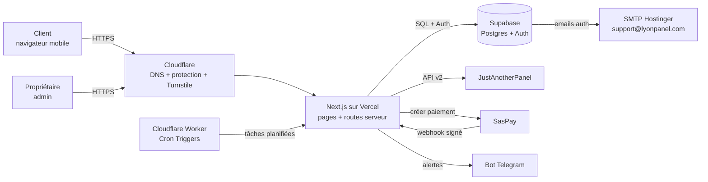

Version texte :
```
Client/Admin --HTTPS--> Cloudflare --> Next.js (Vercel) --> Supabase (DB + Auth) --> SMTP Hostinger
                                          |-- JAP API (commandes, services, statuts)
                                          |-- SasPay (paiements) <-- webhook
                                          |-- Telegram (alertes propriétaire)
                                          +-- Cloudflare Worker cron (sync, rattrapage)
```

## 2. Diagramme des utilisateurs (cas d'utilisation)

Deux acteurs humains : le **client** et le **propriétaire** (seul admin, décidé).

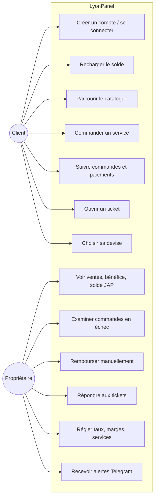

Acteurs systèmes : SasPay (confirme les paiements), JAP (exécute les commandes), Cloudflare Worker cron (déclenche les tâches).

## 3. Composants et communication

| Composant | Rôle | Parle à |
|---|---|---|
| **Pages publiques** (Next.js, rendu serveur) | Accueil, plateformes, FAQ, légal (SEO) | Supabase (catalogue en lecture, cache) |
| **Espace client** | Tableau de bord, commander, recharger, historique, tickets | Routes serveur |
| **Admin** `/admin` | Tableau de bord du propriétaire | Routes serveur (rôle admin) |
| **Routes serveur** (Route Handlers / Server Actions) | Toute la logique : prix, débit, appels JAP/SasPay | Supabase, JAP, SasPay, Telegram |
| **Webhook SasPay** `/api/webhooks/saspay` | Reçoit les confirmations de paiement | Supabase |
| **Tâches planifiées** `/api/cron/*` | Sync services, statuts, rattrapage paiements, solde JAP | JAP, SasPay, Supabase, Telegram |
| **Supabase Postgres** | Données + fonctions SQL atomiques (débit, crédit) + RLS | — |
| **Supabase Auth** | Comptes, sessions, mot de passe oublié | SMTP Hostinger |

**Pas de file d'attente séparée** (mon choix) : un petit **Cloudflare Worker** (Cron Triggers, gratuit) appelle `/api/cron/*` avec `CRON_SECRET` ; les tables d'état dans Postgres suffisent au départ.

**Pourquoi pas Vercel Cron** : l'offre gratuite de Vercel ne lance les crons qu'une fois par jour, alors qu'il en faut toutes les 5 à 10 min.

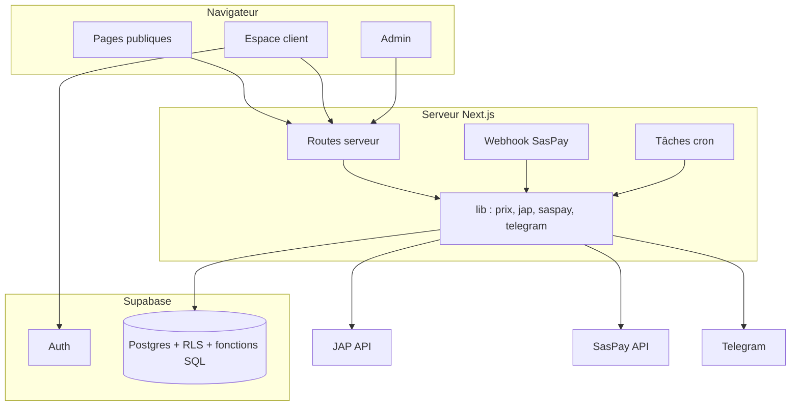

## 4. Choix techniques et pourquoi

| Choix | Pourquoi | Ne pas remplacer par |
|---|---|---|
| **Next.js (App Router) + TypeScript** | SEO (rendu serveur), front + back dans un projet, natif Vercel | Remix, SPA Vite, Express séparé |
| **Tailwind CSS** | Rapide, suit `docs/05-design-system.md` | CSS-in-JS, Bootstrap, kit UI lourd |
| **GSAP + Lenis** | Animations légères demandées | Framer Motion en plus |
| **Supabase** (Postgres, Auth, RLS) | Base + comptes gratuits, sécurité par ligne, fonctions SQL atomiques | Firebase, autre base, NextAuth |
| **Vercel** | Hébergement gratuit, Cron intégré | VPS, Docker |
| **Cloudflare** | DNS, protection, Turnstile gratuit | reCAPTCHA |
| **SasPay** | Mobile Money Afrique de l'Ouest et du Centre | Stripe, PayPal (v1) |
| **JAP API v2** | Fournisseur unique des services | — |
| **Telegram Bot API** | Alertes propriétaire, gratuit | Email, Slack |
| **SMTP Hostinger** | Emails depuis support@lyonpanel.com (décidé) | Resend, SendGrid (v1) |
| **Zod** (mon choix) | Validation des entrées côté serveur | — |
| **Lucide** | Icônes simples | — |

npm, GitHub privé (mon choix, nécessaire au déploiement Vercel).

## 5. Diagrammes de séquence

### 5.1 Inscription
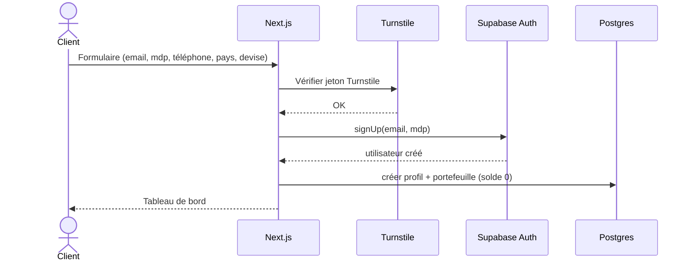

### 5.2 Dépôt (recharge)
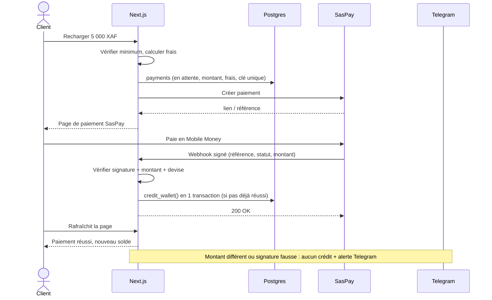

### 5.3 Rattrapage d'un webhook manqué
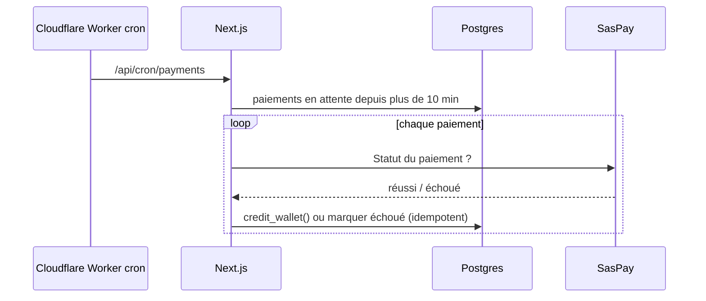

### 5.4 Commande d'un service
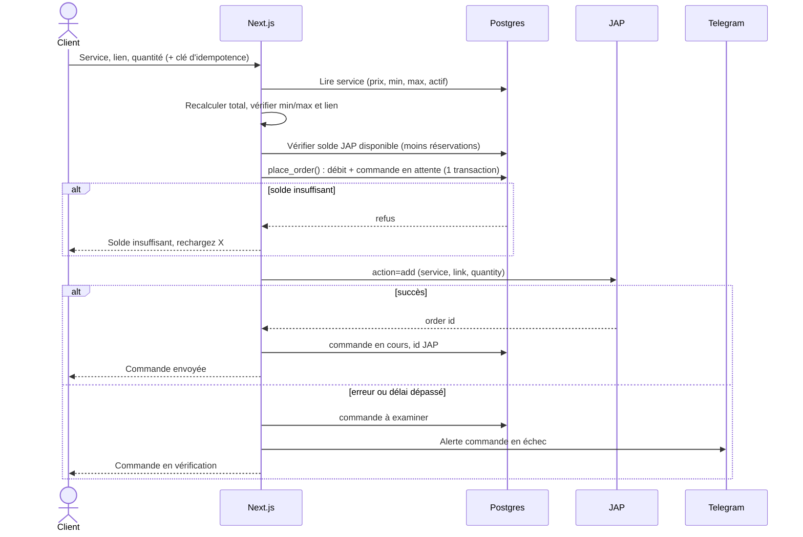

### 5.5 Suivi des statuts
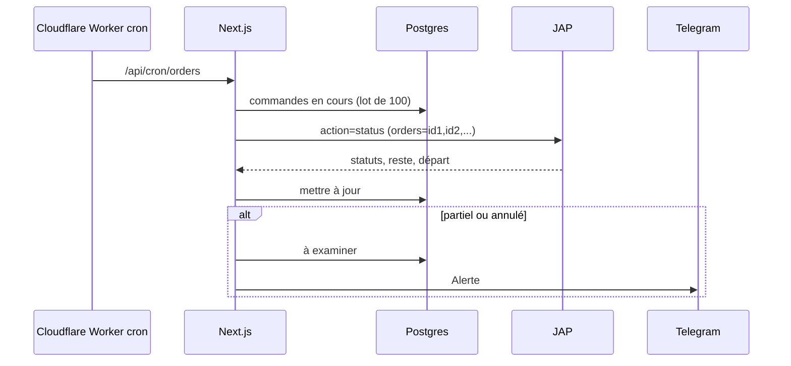

### 5.6 Ticket et remboursement
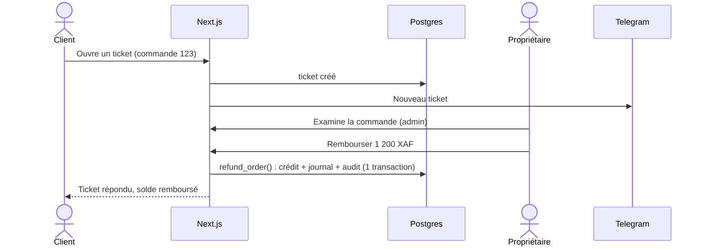

### 5.7 Synchronisation du catalogue et solde JAP
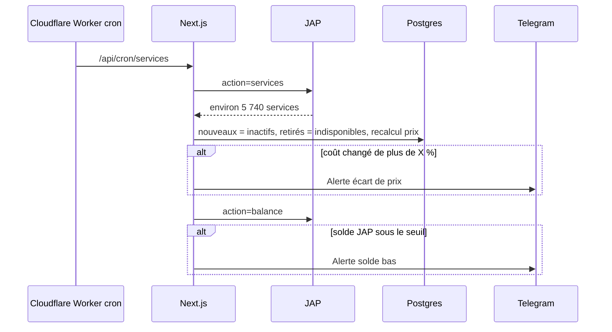

Fréquences (mon choix) : paiements 5 min, statuts 10 min, services 1 h.

## 6. Cycle de vie d'une commande

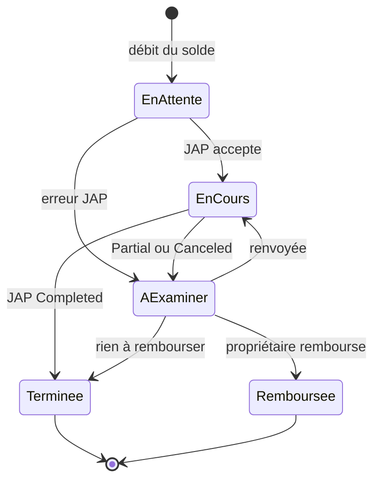

Paiement : `créé → en attente → réussi | échoué` (jamais de retour en arrière).

## 7. Modèle de données

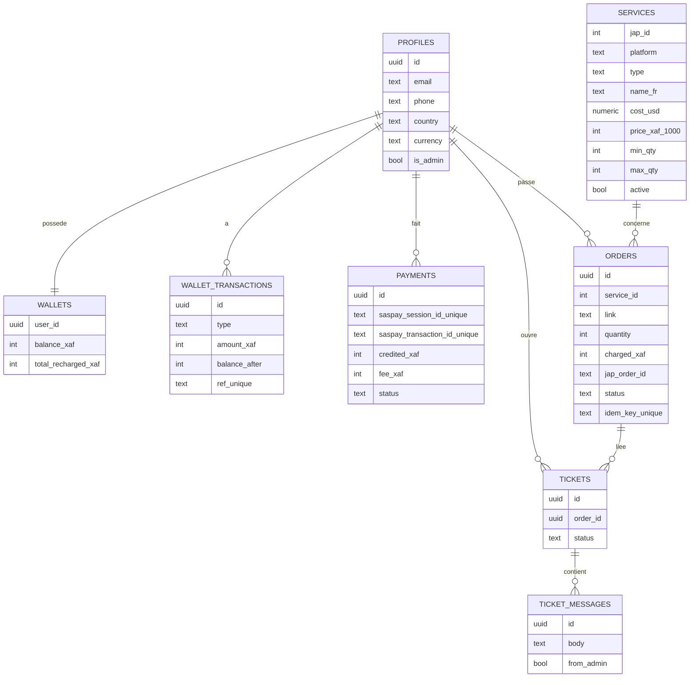

Plus : `settings` (taux, marges, seuils) et `audit_log`. Détails : `docs/02-architecture-et-securite.md`.

## 8. Déploiement

**Cible : serverless sur Vercel (offre gratuite). Pas de VPS ni Docker** (décidé : offres gratuites).

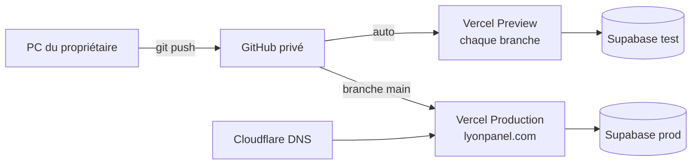

- Deux projets Supabase : **test** et **production** (mon choix ; l'offre gratuite en permet 2).
- Secrets uniquement dans les variables Vercel : `JAP_API_KEY`, `SASPAY_*`, `SUPABASE_SERVICE_ROLE_KEY`, `TELEGRAM_BOT_TOKEN`, `TELEGRAM_CHAT_ID`, `TURNSTILE_SECRET`, `CRON_SECRET`.
- Migrations SQL versionnées dans `supabase/migrations`.
- **Vercel gratuit (Hobby) pour le moment** (décidé). Conséquences :
  - crons faits par un **Cloudflare Worker** gratuit (`workers/cron/`), pas par Vercel ;
  - fonctions limitées en durée : chaque appel JAP/SasPay a un délai de 10 s, la sync du catalogue se fait par lots ;
  - l'offre Hobby est prévue pour un usage **non commercial** : passer à **Vercel Pro** (≈ 20 $/mois) dès que le site gagne de l'argent régulièrement ou si Vercel le demande. À revoir après le lancement limité.

## 9. Intégrations tierces

| Service | Usage | État |
|---|---|---|
| **SasPay** | Recharges Mobile Money + carte, webhooks | Compte marchand + mode test à obtenir |
| **JAP API v2** | Services, commandes, statuts, solde | Compte existant ; **clé à régénérer** |
| **Supabase Auth** | Comptes email + mot de passe, sessions | Compte existant |
| **SMTP Hostinger** | Emails (mot de passe oublié) depuis support@lyonpanel.com | Boîte à créer après achat du domaine |
| **Cloudflare** | Domaine, DNS, Turnstile | Domaine **à acheter** (conseil : Cloudflare Registrar) |
| **Telegram Bot** | Alertes au propriétaire (seul destinataire) | **À créer** avec @BotFather |
| **Google Analytics** | Statistiques de visite | À créer |
| **GitHub** | Code source, déploiement | À créer si absent |

## 10. Sécurité (résumé)

- Un seul admin : le propriétaire (`is_admin = true`, décidé). `/admin` contrôlé côté serveur + 2e facteur (mon choix).
- Prix, marges, débits, crédits : uniquement côté serveur, par fonctions SQL atomiques.
- RLS : chaque client ne lit que ses lignes ; aucune écriture de solde depuis le navigateur.
- Webhook SasPay : signature vérifiée, référence unique, montant contrôlé.
- Routes cron protégées par `CRON_SECRET`.
- Limitation de débit sur inscription, connexion, commandes, recharges.
