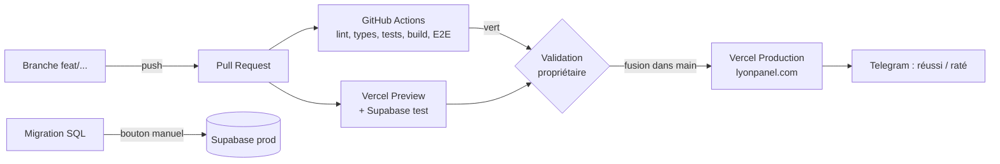

# LyonPanel — CI / CD (vérification et mise en ligne)

Statut : **validé par le propriétaire le 2026-11-07**. « (mon choix) » = décidé par Claude, à vérifier.
Liés : `CONVENTIONS.md` (branches, commits), `TESTING.md`, `ENV_SETUP.md`, `ARCHITECTURE.md §8`.

## 0. Décisions du propriétaire

| # | Décision |
|---|---|
| 6 | Chaque modification validée part en ligne automatiquement, après une **version de test privée** (Vercel Preview) que le propriétaire peut ouvrir |
| 7 | Migrations de la base de production : lancées par **un bouton** (manuel) |
| 8 | Retour à la version précédente **en un clic** sur Vercel |
| 9 | **Message Telegram** à chaque mise en ligne réussie ou ratée |
| — | `main` protégée, CI verte et validation du propriétaire obligatoires (`CONVENTIONS.md`) |

## 1. Vue d'ensemble



## 2. Environnements

| Environnement | Déclencheur | Base | JAP | SasPay | Adresse |
|---|---|---|---|---|---|
| Local | `npm run dev` | Supabase local (Docker) | mock | test | localhost:3000 |
| Preview | chaque push sur une branche / PR | Supabase **test** | mock | test | `lyonpanel-git-<branche>.vercel.app` (protégée par mot de passe Vercel, mon choix) |
| Production | fusion dans `main` | Supabase **prod** | live | live | lyonpanel.com |

## 3. Intégration continue (GitHub Actions)

Fichier `.github/workflows/ci.yml`, sur chaque PR et chaque push vers `main` :

| Étape | Commande | Bloquante |
|---|---|---|
| 1. Installation | `npm ci` (Node depuis `.nvmrc`, cache npm) | oui |
| 2. Mise en forme | `npm run format:check` | oui |
| 3. Lint | `npm run lint` | oui |
| 4. Types | `npm run typecheck` | oui |
| 5. Tests unitaires + couverture | `npm test -- --coverage` (seuils `TESTING.md §3`) | oui |
| 6. Base locale | `supabase start` puis `supabase db reset` (migrations + seed) | oui |
| 7. Tests intégration / base | `npm run test:db` | oui |
| 8. Construction | `npm run build` | oui |
| 9. E2E | `npm run test:e2e` (Android + ordinateur) contre la version construite | oui |
| 10. Sécurité | `npm audit --audit-level=high` + scan de secrets (gitleaks, mon choix) | oui |
| 10 bis. Aucun secret envoyé au navigateur | Après le build, `scripts/check-client-bundle.mjs` cherche dans `.next/static/**` (fichiers envoyés au navigateur) : les **valeurs** des variables secrètes de la CI, et les motifs `sk_live_`, `sk_test_`, `service_role`, `JAP_API_KEY`, `SASPAY_`, `TELEGRAM_BOT_TOKEN`, `CRON_SECRET`, `SENTRY_AUTH_TOKEN`. Une seule trouvaille = échec | oui |
| 11. Vérif migrations | toute nouvelle migration doit s'appliquer sur une base vide **et** sur la base précédente | oui |

Résultats : rapport de couverture et traces Playwright gardés 7 jours en artefacts.
Durée visée : < 12 min.

## 4. Protection de `main` (réglages GitHub)

- Pull request obligatoire, **1 validation** (le propriétaire).
- Statut `ci` vert obligatoire ; branche à jour avec `main`.
- Pas de push direct, pas de force-push, pas de suppression de `main`.
- Règle appliquée aussi aux administrateurs du dépôt.
- Dependabot : PR de sécurité, mêmes règles.

## 5. Déploiement continu (Vercel)

- Vercel connecté au dépôt `lyon32/lyonpanel`.
- **Preview** automatique pour chaque PR : le lien apparaît dans la PR ; le propriétaire peut tester avant de valider.
- **Production** automatique à la fusion dans `main`, seulement si la CI est verte (option Vercel « ignored build step » qui attend le statut, mon choix).
- Variables d'environnement séparées Preview / Production (`ENV_SETUP.md §2`).
- Tâches planifiées : **Cloudflare Worker** `workers/cron/` (Cron Triggers), déployé par `wrangler deploy` dans le workflow `deploy-cron.yml` ; il appelle seulement l'URL de Production. Pas de crons Vercel (offre gratuite = 1 par jour).

## 6. Migrations de base de données (bouton manuel)

1. Une migration arrive dans sa **propre PR** (`CONVENTIONS.md §4`), testée par la CI (§3 étape 11).
2. Après fusion : elle est appliquée **automatiquement sur Supabase test** (`.github/workflows/migrate-test.yml`).
3. Pour la production, le propriétaire clique **« Run workflow »** sur `.github/workflows/migrate-prod.yml` dans GitHub Actions :
   - environnement GitHub `production` avec **approbation obligatoire** du propriétaire ;
   - sauvegarde (`supabase db dump`) gardée en artefact 30 jours ;
   - `supabase db push` vers le projet prod ;
   - message Telegram « migration réussie / ratée ».
4. Règle : les migrations sont **compatibles avec la version précédente du code** (ajouter une colonne avant de l'utiliser, la supprimer seulement après). Ordre : migration d'abord, code ensuite.

## 7. Retour en arrière

| Problème | Action |
|---|---|
| Le site casse après une mise en ligne | Vercel → Deployments → version précédente → **« Promote to Production »** (un clic, < 1 min) |
| La correction est simple | Nouvelle PR `fix/...`, chemin normal |
| Une migration pose problème | Nouvelle migration qui corrige (on ne modifie jamais une migration appliquée) ; en dernier recours, restauration de la sauvegarde faite avant la migration |

## 8. Notifications Telegram

Même bot que les alertes (`TELEGRAM_BOT_TOKEN`, `TELEGRAM_CHAT_ID` en secrets GitHub).

| Événement | Message |
|---|---|
| Mise en ligne Production réussie | ✅ « LyonPanel en ligne — <commit> par <auteur> » |
| Mise en ligne Production ratée | ❌ « Échec de mise en ligne — <lien des journaux> » |
| CI rouge sur `main` | ❌ « Tests en échec sur main » |
| Migration prod réussie / ratée | ✅ / ❌ avec le nom de la migration |
| Alerte sécurité Dependabot | ⚠️ « Faille dans <paquet> » |

Source : webhook de déploiement Vercel → route `/api/webhooks/vercel` (signature vérifiée), et une étape `curl` à la fin des workflows GitHub (mon choix).

## 9. Secrets du pipeline

| Où | Secrets |
|---|---|
| GitHub (Actions) | `CLOUDFLARE_API_TOKEN`, `CLOUDFLARE_ACCOUNT_ID`, `SUPABASE_ACCESS_TOKEN`, `SUPABASE_DB_PASSWORD_TEST`, `SUPABASE_DB_PASSWORD_PROD`, `SUPABASE_PROJECT_REF_TEST`, `SUPABASE_PROJECT_REF_PROD`, `TELEGRAM_BOT_TOKEN`, `TELEGRAM_CHAT_ID` |
| Vercel | variables de `ENV_SETUP.md §2`, séparées Preview / Production, + `VERCEL_WEBHOOK_SECRET` |

Les secrets de production sont dans l'**environnement GitHub `production`**, accessible seulement au workflow de migration après approbation.

## 10. Fichiers du pipeline

```
.github/
├─ workflows/
│  ├─ ci.yml             # vérifications sur chaque PR
│  ├─ migrate-test.yml   # migrations auto sur Supabase test après fusion
│  ├─ migrate-prod.yml   # bouton manuel, approbation, sauvegarde
│  └─ deploy-cron.yml    # déploie le Worker Cloudflare des tâches planifiées
├─ dependabot.yml
└─ pull_request_template.md
vercel.json              # en-têtes de sécurité
workers/cron/            # Cloudflare Worker : wrangler.toml (horaires) + index.ts (appelle /api/cron/*)
```
