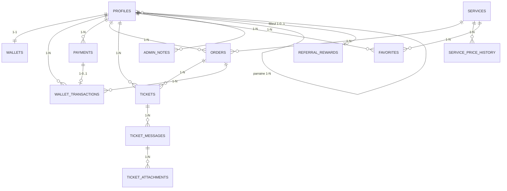

# LyonPanel — Modèle de données

Statut : **validé par le propriétaire le 2026-11-07**. « (mon choix) » = décidé par Claude, à vérifier.
Base : **Supabase Postgres**. Montants en **XAF entiers** (`bigint`), jamais en décimal flottant.

## 0. Décisions du propriétaire prises en compte

| # | Décision |
|---|---|
| 1 + 9 | Suppression de compte : on efface email, téléphone, messages ; commandes et paiements gardés sous « client supprimé » |
| 2 | Historique gardé pour toujours |
| 3 | Le propriétaire peut bloquer un client |
| 4 | Commentaires personnalisés gardés avec la commande |
| 5 | Pièces jointes (captures) dans les tickets |
| 6 | Historique des prix de chaque service |
| 7 | Un seul compte par numéro de téléphone |
| 8 | Pays seulement (pas de ville) |
| 10 | Opérateur Mobile Money non enregistré ; l'admin présente les stats par pays, montants, etc. |
| 11 | Notes privées du propriétaire sur un client |
| 12 | Services favoris |
| 13/17/18 | **Pas de codes promo** |
| 14/16 | Parrainage : **5 % de la 1re recharge** du filleul, versé au parrain |
| 15 | Remise personnalisée par client (en plus de la remise automatique 10 %) |

## 1. Diagramme entité-relation



Tables isolées : `settings`, `audit_log`, `jap_balance_snapshots`, `login_attempts`, `rate_limits`, `allowed_signups`, `idempotency_keys`.

## 2. Types énumérés

```sql
create type user_status    as enum ('active','blocked','deleted');
create type payment_status as enum ('created','pending','succeeded','failed');
create type order_status   as enum ('pending','in_progress','completed','partial','canceled','to_review','refunded');
create type tx_type        as enum ('recharge','order','refund','referral_bonus','adjustment');
create type ticket_status  as enum ('open','answered','closed');
create type currency_code  as enum ('XAF','XOF','USD');
```

## 3. Schémas des tables

### profiles — un client (lié à `auth.users`)
| Champ | Type | Contraintes |
|---|---|---|
| id | uuid | PK, = `auth.users.id` |
| email | text | unique, null si supprimé |
| phone | text | **unique**, format E.164 (`+2376…`), null si supprimé |
| country | char(2) | code ISO (CM, SN, CI…), non null |
| display_currency | currency_code | défaut `XAF` |
| language | text | `fr` ou `en`, défaut `fr` |
| status | user_status | défaut `active` |
| is_admin | boolean | défaut false ; un seul `true` (le propriétaire) |
| referral_code | text | unique, 8 caractères, généré à l'inscription |
| referred_by | uuid | FK → profiles.id, null |
| custom_discount_pct | numeric(5,2) | null ; 0–50 |
| daily_spend_limit_xaf | bigint | défaut 500 000 ; plafond de commandes sur 24 h glissantes (SECURITY_NOTES §5) |
| blocked_reason | text | null |
| created_at / updated_at | timestamptz | défaut now() |
| deleted_at | timestamptz | null |

### wallets — solde du client
| Champ | Type | Contraintes |
|---|---|---|
| user_id | uuid | PK, FK → profiles |
| balance_xaf | bigint | ≥ 0 (check) |
| total_recharged_xaf | bigint | ≥ 0 ; sert au seuil de remise 50 000 XAF |
| updated_at | timestamptz | |

Le solde ne se modifie **que** par les fonctions SQL (§6), qui écrivent aussi `wallet_transactions`.

### wallet_transactions — journal de chaque mouvement (jamais modifié)
| Champ | Type | Contraintes |
|---|---|---|
| id | uuid | PK |
| user_id | uuid | FK → profiles |
| type | tx_type | non null |
| amount_xaf | bigint | + crédit / − débit, ≠ 0 |
| balance_after_xaf | bigint | ≥ 0 |
| payment_id | uuid | FK → payments, null |
| order_id | uuid | FK → orders, null |
| ref | text | **unique** (anti-doublon : `pay:<id>`, `order:<id>`, `refund:<id>`, `ref:<id>`) |
| note | text | null (motif d'ajustement admin) |
| created_by | uuid | null (admin si manuel) |
| created_at | timestamptz | |

### payments — recharges SasPay
| Champ | Type | Contraintes |
|---|---|---|
| id | uuid | PK |
| user_id | uuid | FK → profiles |
| saspay_session_id | text | **unique**, id de la session de checkout SasPay |
| saspay_transaction_id | text | **unique**, `data.id` du webhook (anti-doublon), null tant que non payé |
| credited_xaf | bigint | > 0 ; ≥ minimum |
| fee_xaf | bigint | ≥ 0 ; `fee` reçu de SasPay (mode ADD_ON, payé par le client) |
| total_paid | bigint | `charged` SasPay = montant + frais, dans la devise de paiement |
| pay_currency | text | ex. XAF, XOF |
| status | payment_status | défaut `created` |
| saspay_network | text | opérateur (ex. `mtn_cm`), pour les statistiques admin |
| idem_key | text | unique (double clic) |
| raw_webhook | jsonb | dernière charge reçue (sans données sensibles) |
| created_at / succeeded_at | timestamptz | |

### services — catalogue (copie travaillée de JAP)
| Champ | Type | Contraintes |
|---|---|---|
| id | int | PK = id JAP |
| platform | text | non null (tiktok, instagram, facebook…) |
| category | text | abonnés, likes, vues… |
| name_fr | text | reconstruit (sans prix) |
| jap_name | text | nom d'origine (admin seulement) |
| jap_type | text | Default, Custom Comments… |
| cost_usd_1000 | numeric(12,4) | coût JAP |
| margin_pct | numeric(6,2) | null = règle par plateforme |
| price_xaf_1000 | bigint | prix client calculé |
| min_qty / max_qty | int | > 0, min ≤ max |
| refill / cancel / dripfeed | boolean | |
| active | boolean | défaut false (activé par l'admin) |
| available | boolean | false si retiré chez JAP |
| sort_order | int | |
| updated_at | timestamptz | |

### service_price_history — chaque changement de coût ou de prix
| Champ | Type |
|---|---|
| id | bigserial PK |
| service_id | int FK → services |
| cost_usd_1000 | numeric(12,4) |
| price_xaf_1000 | bigint |
| margin_pct | numeric(6,2) |
| usd_xaf_rate | numeric(10,2) |
| reason | text (`sync`, `admin`, `taux`) |
| changed_at | timestamptz |

### orders — commandes
| Champ | Type | Contraintes |
|---|---|---|
| id | uuid | PK |
| short_id | bigserial | unique, numéro lisible (#10234) |
| user_id | uuid | FK → profiles |
| service_id | int | FK → services |
| link | text | non null |
| quantity | int | > 0 |
| comments | text[] | null ; commentaires personnalisés (décidé) |
| price_xaf_1000 | bigint | prix au moment de la commande |
| discount_pct | numeric(5,2) | remise appliquée |
| charged_xaf | bigint | > 0, débité |
| cost_usd | numeric(12,4) | coût JAP estimé (bénéfice admin) |
| jap_order_id | bigint | unique, null |
| status | order_status | défaut `pending` |
| start_count / remains | int | null |
| idem_key | text | **unique** |
| error | text | null |
| created_at / updated_at | timestamptz | |

### favorites
user_id uuid FK · service_id int FK · created_at. PK (user_id, service_id).

### tickets / ticket_messages / ticket_attachments
- **tickets** : id uuid PK · user_id FK · order_id FK null · subject text · status ticket_status · created_at · updated_at.
- **ticket_messages** : id uuid PK · ticket_id FK · from_admin bool · body text (null si supprimé) · created_at.
- **ticket_attachments** : id uuid PK · message_id FK · storage_path text · mime text (`image/jpeg|png|webp`) · size_bytes int (≤ 2 Mo) · created_at.

Fichiers dans **Supabase Storage**, bucket privé `ticket-attachments`, compressés dans le navigateur avant envoi (mon choix).

### admin_notes — notes privées du propriétaire
id uuid PK · user_id FK → profiles · body text · created_at. **Jamais lisible par le client.**

### referral_rewards — bonus de parrainage
| Champ | Type | Contraintes |
|---|---|---|
| id | uuid | PK |
| referrer_id | uuid | FK → profiles (parrain) |
| referee_id | uuid | FK → profiles, **unique** (une seule fois par filleul) |
| payment_id | uuid | FK → payments (1re recharge) |
| amount_xaf | bigint | = 5 % de `credited_xaf`, arrondi à l'inférieur |
| created_at | timestamptz | |

### settings — réglages (admin seulement)
key text PK · value jsonb · updated_at.
Clés : `usd_xaf_rate` (600), `margins` (par plateforme + paliers), `min_recharge_xaf` (3000), `auto_discount` ({threshold_xaf: 50000, pct: 10}), `referral_pct` (5), `jap_low_balance_usd` (5), `saspay_fee_pct`, `price_alert_pct`.

### login_attempts — essais de connexion (blocage 5 échecs / 15 min)
id bigserial PK · identifier_hash text (email/téléphone haché) · ip_hash text · success bool · created_at. Index (identifier_hash, created_at), (ip_hash, created_at). Purge après 30 jours.

### rate_limits — compteurs de débit par client
key text (ex. `orders:<user_id>`) · window_start timestamptz · count int. PK (key, window_start). Purge après 1 jour.

### allowed_signups — liste d'emails autorisés (lancement limité, Phase 15)
email text PK · added_at. Utilisée seulement si le réglage `limited_launch` = true.

### idempotency_keys — réponses mémorisées
key uuid · user_id uuid · route text · request_hash text · response jsonb · created_at. PK (user_id, key). Même clé + contenu différent → `409 IDEMPOTENCY_CONFLICT`. Purge après 24 h.

### audit_log — actions sensibles
id bigserial PK · actor_id uuid null · action text · target_table text · target_id text · details jsonb · created_at.

### jap_balance_snapshots — suivi du solde JAP
id bigserial PK · balance_usd numeric(12,4) · reserved_usd numeric(12,4) · taken_at timestamptz.

## 4. Index

| Table | Index |
|---|---|
| orders | (user_id, created_at desc) · (status) where status in ('pending','in_progress','to_review') · unique(jap_order_id) · unique(idem_key) |
| payments | unique(saspay_session_id) · unique(saspay_transaction_id) · (status, created_at) where status='pending' · (user_id, created_at desc) |
| wallet_transactions | (user_id, created_at desc) · unique(ref) |
| services | (platform, category, active) · (active, available) |
| service_price_history | (service_id, changed_at desc) |
| tickets | (status, updated_at desc) · (user_id) |
| profiles | unique(email) · unique(phone) · unique(referral_code) · (country) · (referred_by) |
| audit_log | (created_at desc) |

Pagination par curseur (`created_at`, `id`) sur commandes, transactions, tickets (mon choix).

## 5. Sécurité des lignes (RLS)

| Table | Client | Propriétaire |
|---|---|---|
| profiles | lire/modifier **sa** ligne (sauf status, is_admin, custom_discount_pct, referred_by) | tout |
| wallets, wallet_transactions, payments, orders | **lire** ses lignes ; aucune écriture directe | tout |
| services | via la vue `services_public` : actifs et disponibles, sans `jap_name`, `cost_usd_1000`, `margin_pct` | tout |
| favorites, tickets, ticket_messages, ticket_attachments | ses lignes | tout |
| admin_notes, settings, audit_log, referral_rewards, service_price_history, jap_balance_snapshots, login_attempts, rate_limits, allowed_signups, idempotency_keys | **aucun accès** | tout |

Client bloqué : peut lire, ne peut ni recharger ni commander (contrôlé dans les fonctions).

## 6. Fonctions SQL atomiques (seules à toucher l'argent)

| Fonction | Fait, en une transaction |
|---|---|
| `credit_payment(payment_id)` | si non `succeeded` et si `net_amount` = montant demandé : passe `succeeded`, crédite, journalise, augmente `total_recharged_xaf`, verse le bonus parrain si 1re recharge |
| `place_order(user, service, link, qty, comments, idem_key)` | verrouille le portefeuille, recalcule prix + remise, vérifie statut client, min/max, solde ; débite ; crée la commande |
| `refund_order(order_id, amount, admin_id)` | crédite, journalise, passe `refunded`, écrit `audit_log` |
| `admin_adjust(user, amount, note, admin_id)` | ajustement manuel + audit |
| `anonymize_user(user_id)` | email/téléphone/messages → null, `status='deleted'`, supprime pièces jointes et favoris, garde commandes/paiements |

Remise appliquée = la plus grande entre la remise auto 10 % (si seuil atteint) et `custom_discount_pct` ; elles ne s'additionnent pas (mon choix).

## 7. Migrations et versions

- Outil : **Supabase CLI**. Fichiers SQL `supabase/migrations/AAAAMMJJHHMMSS_description.sql`, dans Git.
- On ne modifie **jamais** une migration déjà appliquée : on en ajoute une nouvelle.
- Ordre : projet test → vérification → production.
- Types TypeScript régénérés après chaque migration (`supabase gen types`).
- `supabase/seed.sql` : réglages par défaut uniquement, jamais de vraies données.
- Sauvegarde quotidienne Supabase + export manuel avant chaque migration en production ; test de restauration avant lancement.
