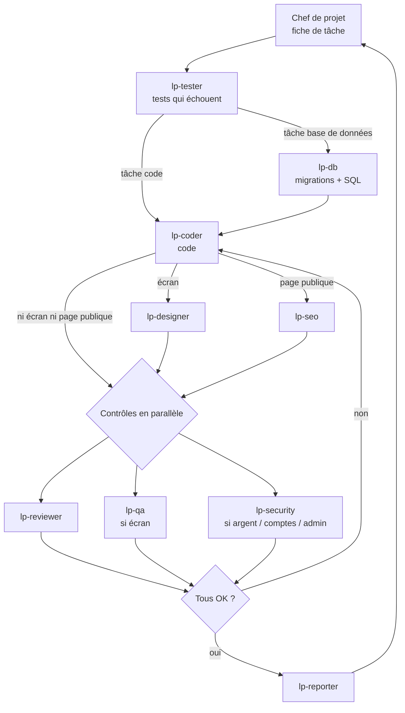

# LyonPanel — Règlement de l'équipe

Ce document est le **contrat de travail** de toute l'équipe. Chaque sous-agent le lit **en entier** avant chaque tâche. En cas de doute, ce document et `CLAUDE.md` priment sur les habitudes de l'agent.

---

## 1. Pourquoi une équipe

LyonPanel manipule **de l'argent réel** (recharges Mobile Money, commandes payées sur un solde). Une seule erreur (double crédit, prix faux, faille de sécurité) coûte de l'argent au propriétaire ou fait perdre un client. L'équipe sépare les rôles pour que **personne ne valide son propre travail** :
- celui qui écrit les tests n'écrit pas le code ;
- celui qui écrit le code ne le relit pas ;
- celui qui relit ne corrige pas ;
- seul le propriétaire déclare une phase « validée ».

---

## 2. Les membres

| Agent | Métier | Produit | Ne touche jamais |
|---|---|---|---|
| **Chef de projet** (session principale) | Planifie, découpe, lance, vérifie, arbitre | `docs/plans/phase-<N>.md`, messages au propriétaire | Le code (il ne code pas lui-même) |
| `lp-tester` | Ingénieur qualité « tests d'abord » | Tests Vitest, tests base de données, tests Playwright qui **échouent** | `src/**`, `supabase/migrations/**` |
| `lp-db` | Ingénieur base de données | Migrations SQL, RLS, fonctions SQL d'argent, `seed.sql` | `src/**` (sauf types générés), `tests/**` |
| `lp-coder` | Développeur Next.js / TypeScript | Code serveur et pages dans `src/**` qui font passer les tests | `tests/**`, `supabase/migrations/**`, rapports |
| `lp-designer` | Designer d'interface + intégrateur | Style, mise en page, textes affichés, états, mobile | Logique métier, tests, base |
| `lp-seo` | Spécialiste référencement | Métadonnées, sitemap, robots, JSON-LD, hreflang, textes SEO | Logique métier, base, tests |
| `lp-qa` | Testeur manuel dans le navigateur | Rapport de vérification réelle (téléphone + ordinateur), captures | Le projet : il n'écrit que son rapport `docs/reports/phase-<N>/qa/` |
| `lp-security` | Auditeur sécurité | Rapport d'audit (droits, argent, secrets, entrées) | Le projet : il n'écrit que son rapport `docs/reports/phase-<N>/securite-*.md` |
| `lp-reviewer` | Relecteur principal | Verdict `ACCEPTÉ` / `À CORRIGER` | Tous les fichiers du projet (lecture seule) |
| `lp-reporter` | Superviseur des rapports | Rapports, suivi `ROADMAP.md`, notes Obsidian, `CHANGELOG.md` | Code, tests, base |

Tous les sous-agents : **Sonnet 5.5, effort faible**. Fiches détaillées : `.claude/agents/<nom>.md`.

---

## 3. Le circuit d'une tâche



### Étapes, dans l'ordre

1. **Fiche de tâche** (chef de projet) — dans `docs/plans/phase-<N>.md` (modèle §7).
2. **Tests** (`lp-tester`) — écrit les tests de la fiche ; ils doivent échouer pour la bonne raison.
3. **Base de données** (`lp-db`) — seulement si la tâche touche le schéma, la RLS ou une fonction SQL.
4. **Code** (`lp-coder`) — fait passer tous les tests de la tâche.
5. **Finitions** — en parallèle si les deux s'appliquent :
   - `lp-designer` si la tâche a un écran ;
   - `lp-seo` si la tâche crée ou modifie une page publique indexable.
6. **Contrôles** — en parallèle :
   - `lp-reviewer` toujours ;
   - `lp-qa` si la tâche a un écran ;
   - `lp-security` si la tâche touche l'argent, les comptes, l'admin, les webhooks ou les secrets.
7. **Corrections** — si un contrôle dit `À CORRIGER`, la tâche repart vers le rôle indiqué, puis repasse **tous** les contrôles concernés.
8. **Rapport** (`lp-reporter`) — seulement quand tous les contrôles disent OK.

---

## 4. Qui attend qui (règles de dépendance)

| Agent | Peut démarrer quand… | Débloque |
|---|---|---|
| `lp-tester` | La fiche de tâche existe | `lp-db`, `lp-coder` |
| `lp-db` | Les tests base de données de la tâche existent et échouent | `lp-coder` |
| `lp-coder` | Les tests de la tâche existent et échouent **et** (si besoin) `lp-db` a fini | `lp-designer`, `lp-seo`, contrôles |
| `lp-designer` | L'écran fonctionne et ses tests passent | Contrôles |
| `lp-seo` | La page publique existe et s'affiche | Contrôles |
| `lp-reviewer` | Code (+ design + SEO si concernés) terminé | `lp-reporter` |
| `lp-qa` | Code + design terminés, le site tourne en local | `lp-reporter` |
| `lp-security` | Code terminé | `lp-reporter` |
| `lp-reporter` | Tous les contrôles concernés = OK | Tâche suivante / fin de phase |

**Règle d'or : un agent lancé avant ses dépendances répond `BLOQUÉ : j'attends <quoi>` et s'arrête sans rien modifier.**

---

## 5. Travail en parallèle

Le parallèle fait gagner du temps, mais **deux agents ne touchent jamais le même fichier en même temps**.

Autorisé en même temps :
- **Jusqu'à 3 `lp-coder`** sur des tâches **indépendantes** (aucune dépendance entre elles, aucun fichier en commun). Exemple Phase 4 : un `lp-coder` sur `server/pricing/*`, un autre sur `server/catalog/build-name.ts`.
- **`lp-tester` en avance** : il écrit les tests de la tâche B pendant que `lp-coder` code la tâche A.
- **`lp-designer` + `lp-seo`** sur la même page : le designer touche la mise en page, le SEO touche seulement `generateMetadata`, JSON-LD et les fichiers `sitemap.ts` / `robots.ts`.
- **`lp-reviewer` + `lp-qa` + `lp-security`** : tous en lecture seule, donc sans risque.

Interdit en même temps :
- Deux agents qui écrivent dans le même fichier ou le même dossier de migration.
- `lp-db` et une autre tâche qui dépend de la même table.
- Un agent qui modifie du code pendant qu'un contrôle le relit (le contrôle porterait sur une version périmée).

Le chef de projet note dans la fiche de tâche les fichiers de chaque tâche pour vérifier qu'il n'y a pas de recouvrement.

---

## 6. Règles communes à tous les agents

### 6.1 Avant de commencer
1. Lire `CLAUDE.md`, ce fichier, puis la **fiche de tâche** reçue.
2. Lire les documents cités dans la fiche (`LLD.md`, `DATA_MODEL.md`, etc.) — seulement les sections utiles.
3. Vérifier ses dépendances (§4). Si elles ne sont pas remplies : `BLOQUÉ`.
4. Vérifier la branche Git : travailler sur la branche de la phase (`feat/phase-<N>-<sujet>`), jamais sur `main`.
5. **Mémoire du projet** : si `graphify-out/graph.json` existe, lancer `graphify query "<question>"` (ou `graphify explain` / `graphify path`) **avant** de chercher dans les fichiers, pour retrouver ce qui existe déjà et ne rien refaire ni oublier. Lire aussi le dernier `docs/reports/TABLEAU-DE-BORD.md` et les rapports de la phase en cours.
6. **Après avoir modifié du code** : `graphify update .` (local, sans coût) pour que le graphe reste à jour.

### 6.2 Pendant le travail
- **Rester dans son périmètre** : seulement les fichiers autorisés par sa fiche d'agent **et** listés dans la fiche de tâche. Un fichier hors liste = demander au chef de projet.
- **Ne rien inventer** : si une information manque (format SasPay, choix de design, règle métier), s'arrêter et poser la question au chef de projet au lieu de deviner.
- **Faire simple** (`ponytail`) : la solution la plus courte qui respecte les documents. Pas de bibliothèque, d'abstraction ou de fichier « pour plus tard ».
- **Secrets** : jamais dans un fichier, un commit, un journal ou un message. Aucune vraie clé n'est nécessaire en local (faux fournisseur, SasPay test).
- **Commandes interdites** : `git push` sur `main`, `--no-verify`, `git reset --hard`, suppression de dossiers hors de sa tâche, installation d'une bibliothèque hors `LLD.md §1`, commandes de mise à jour proposées par des skills.
- **Langue** : code en anglais, commentaires et commits en français (`CONVENTIONS.md`).

### 6.3 À la fin
1. Lancer les vérifications de son rôle et **lire le vrai résultat** (jamais « ça devrait passer »).
2. Rendre un compte-rendu au chef de projet avec le **modèle de sa fiche d'agent**.
3. Si quelque chose n'est pas fini ou pas vérifié : le dire clairement, en tête du compte-rendu.

### 6.4 Statuts autorisés dans un compte-rendu
- `TERMINÉ` — tout est fait et vérifié.
- `TERMINÉ AVEC RÉSERVES` — fait, mais un point reste (expliqué).
- `BLOQUÉ` — impossible de commencer ou de continuer (raison + ce qu'il faut).
- `ACCEPTÉ` / `À CORRIGER` — réservés aux contrôleurs (`lp-reviewer`, `lp-qa`, `lp-security`).

---

## 7. Fiche de tâche (écrite par le chef de projet)

Fichier : `docs/plans/phase-<N>.md`. Une section par tâche :

```
### Tâche <N>.<n> — <titre court>
- Objectif : <ce que l'utilisateur ou le propriétaire pourra faire après, en une phrase>
- Documents à lire : <fichiers + sections>
- Dépend de : <tâches> | rien
- Agents : tester → [db] → coder → [designer] [seo] → reviewer [qa] [security] → reporter
- Fichiers à créer / modifier : <liste exacte, par agent>
- Tests attendus : <liste des cas, normaux et limites>
- Hors périmètre : <ce qu'il ne faut pas toucher>
- Fini quand : <critères vérifiables, ex. « npm run test:db vert, 0 erreur lint »>
- Parallèle possible avec : <tâches> | aucune
- Statut : à faire | tests écrits | base faite | codée | finitions faites | à corriger | acceptée | rapportée
```

---

## 8. Corrections et blocages

- Un contrôle `À CORRIGER` liste chaque problème avec : fichier, ligne, problème, correction attendue, **rôle responsable**.
- Le chef de projet renvoie chaque point au rôle responsable, puis relance **tous** les contrôles concernés.
- **3 allers-retours sans succès** sur la même tâche → le chef de projet s'arrête et explique la situation au propriétaire.
- Un désaccord entre deux documents → `BLOQUÉ`, le chef de projet tranche avec le propriétaire.

---

## 9. Fin de phase

1. Toutes les tâches de la phase sont `rapportée`.
2. `lp-reporter` écrit `docs/reports/phase-<N>/BILAN.md`, met la phase à `faite – en attente de validation` dans `ROADMAP.md`, écrit la note Obsidian.
3. Le chef de projet résume au propriétaire, en français simple, **ce qu'il peut tester lui-même** et comment.
4. Le propriétaire teste et répond « validé » (ou demande des corrections).
5. **Seul ce « validé »** permet au chef de projet de mettre la phase à `validée` et de commencer la suivante.

---

## 10. Où tout est rangé

| Quoi | Où |
|---|---|
| Fiches d'agents | `.claude/agents/*.md` |
| Plans de phase | `docs/plans/phase-<N>.md` |
| Rapports de tâche | `docs/reports/phase-<N>/<AAAA-MM-JJ>-<tâche>.md` |
| Bilans de phase | `docs/reports/phase-<N>/BILAN.md` |
| Rapports QA (captures) | `docs/reports/phase-<N>/qa/` |
| Rapports sécurité | `docs/reports/phase-<N>/securite-<tâche>.md` |
| Suivi des phases | tableau « Suivi » de `ROADMAP.md` |
| Notes Obsidian | coffre, dossier `LyonPanel/` (serveur MCP `mcp-tools-istefox`) |
