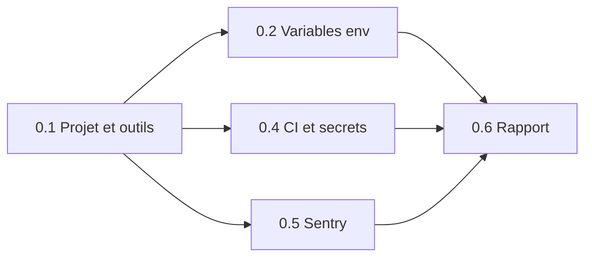

# Phase 0 — Socle du projet : plan d'exécution

> **Pour l'équipe :** exécuté par le chef de projet avec les sous-agents de `.claude/agents/` selon `TEAM.md` (méthode `superpowers:subagent-driven-development`). Chaque tâche suit le circuit `lp-tester` → `lp-coder` → contrôles → `lp-reporter`. Cases à cocher `- [ ]` pour le suivi.

**Objectif :** un projet Next.js vide mais complet, qui démarre, se vérifie tout seul (lint, types, tests, build, CI) et remonte ses erreurs à Sentry, sans aucune logique métier.

**Approche :** on crée le projet avec les versions exactes et on installe d'un coup toutes les dépendances de la phase (les tâches suivantes ne touchent plus `package.json`, ce qui permet de les lancer en parallèle), puis trois briques indépendantes : variables d'environnement, CI, Sentry.

**Technique :** Next.js (App Router) + TypeScript strict, Tailwind 4, Zod, Vitest, Playwright, ESLint, Prettier, Husky + lint-staged, `@sentry/nextjs`, GitHub Actions.

**Documents de référence :** `ROADMAP.md` (Phase 0), `CLAUDE.md` (Tâche de la session), `LLD.md` §1–2 et §7, `CONVENTIONS.md`, `ENV_SETUP.md`, `TESTING.md`, `CI_CD.md` §3, `SECURITY_NOTES.md` §7, skill `sentry-instrument`.

## Décision D1 — versions : ✅ ACCEPTÉE par le propriétaire le 2026-11-07

**Retenu : Next.js 16.4.5, Zod 4.6.7, TypeScript 5.9.3** (et le reste du tableau ci-dessous).

Vérifiées le 2026-11-07 avec `npm view`. Plusieurs **versions majeures** ont changé depuis `CONVENTIONS.md` ; changer de majeure demande l'accord du propriétaire.

| Paquet | Documents | Dernière stable | Proposé | Pourquoi |
|---|---|---|---|---|
| next | 15 | 16.4.5 | **16.4.5** | Projet neuf : partir sur la version maintenue |
| react / react-dom | 19 | 19.3.1 | 19.3.1 | Inchangé |
| typescript | 5 | 7.0.2 | **5.9.3** | TS 7 trop récent : risque d'incompatibilité avec ESLint et Next |
| tailwindcss | 4 | 4.3.5 | 4.3.5 | Inchangé |
| zod | 3 | 4.6.7 | **4.6.7** | Version maintenue |
| next-intl | 4 | 4.14.9 | 4.14.9 | Inchangé (installé en phase 2) |
| vitest | dernière | 5.1.0 | 5.1.0 | — |
| @playwright/test | 1 | 1.65.0 | 1.65.0 | — |
| eslint | dernière | 10.14.0 | celle exigée par `eslint-config-next@16.4.5` | Compatibilité |
| prettier / husky / lint-staged | — | 3.9.10 / 9.1.7 / 17.6.0 | idem | — |
| @sentry/nextjs | — | 11.11.0 | 11.11.0 | — |

Après accord : `lp-reporter` met à jour `CONVENTIONS.md §1` et `ENV_SETUP.md §6` avec les numéros réellement installés.

## Contraintes globales (valables pour toutes les tâches)

- Versions **exactes** (`save-exact=true`, aucun `^` ni `~`), Node **24** (`.nvmrc`), `npm ci` en CI.
- Arborescence et noms de `LLD.md §2` et `§7` ; code en anglais, commentaires et commits **en français** (Conventional Commits).
- Aucun secret dans le dépôt ; `.env.local` jamais commité ; aucune variable secrète en `NEXT_PUBLIC_`.
- Fins de ligne **LF** (`.gitattributes` : `* text=auto eol=lf`).
- Aucune logique métier ; pas de Supabase, pas de shadcn/ui, pas de traductions (phases 1 et 2).
- Branche de travail : `feat/phase-0-socle`, PR vers `main`, jamais de push direct sur `main`.

## Points de vigilance (testés dans la tâche indiquée)

1. **Windows** : fichiers en CRLF qui font échouer Prettier en CI → `.gitattributes` + `format:check` vert après un clone propre (0.1).
2. **`.env.local` commité par erreur** → `.gitignore` + gitleaks en CI (0.4).
3. **Mode « live » en local** (vrai JAP / vrai SasPay) → `loadServerEnv` refuse hors production (0.2).
4. **Sentry reçoit des données personnelles** (email, téléphone, `Authorization`) → `scrubEvent` les retire (0.5).
5. **Secret dans le JavaScript envoyé au navigateur** → `check:bundle` échoue (0.4).

## Ordre et parallélisme

- **0.1** d'abord, seule.
- Puis **0.2, 0.4 et 0.5 en parallèle** (3 `lp-coder`, aucun fichier en commun ; `package.json` n'est modifié que par 0.1, sauf l'ajout du script `check:bundle` par 0.4, seule tâche autorisée à le toucher ensuite).
- **0.6** quand les autres sont acceptées.

---

### Tâche 0.1 — Projet Next.js et outils de qualité

- **Objectif :** `npm run dev` affiche une page « LyonPanel » ; lint, types, tests et build passent ; un commit mal formaté est refusé.
- **Dépend de :** décision D1 (acceptée).
- **Agents :** `lp-tester` → `lp-coder` → `lp-reviewer` → `lp-reporter`.

**Fichiers :**
- Créer : `package.json`, `package-lock.json`, `.npmrc` (`save-exact=true`), `.nvmrc` (`24`), `.gitattributes`, `tsconfig.json` (strict + `noUncheckedIndexedAccess` + `noImplicitOverride`, alias `@/*` → `src/*`), `next.config.ts`, `eslint.config.mjs`, `.prettierrc`, `.prettierignore`, `postcss.config.mjs`, `vitest.config.ts`, `playwright.config.ts`, `.husky/pre-commit`, `.lintstagedrc.json`, `.vscode/extensions.json`, `src/app/layout.tsx`, `src/app/page.tsx`, `src/styles/globals.css`, `src/lib/constants.ts`.
- Créer les dossiers vides de `LLD.md §2` avec un `.gitkeep`.
- Tests : `tests/unit/constants.test.ts`, `tests/e2e/home.spec.ts`.

**Dépendances de toute la phase, installées ici :** `next react react-dom zod server-only @sentry/nextjs` ; dev : `typescript @types/node @types/react @types/react-dom tailwindcss @tailwindcss/postcss eslint eslint-config-next prettier prettier-plugin-tailwindcss husky lint-staged vitest @vitest/coverage-v8 @playwright/test`.

**Scripts :** `dev`, `build`, `start`, `lint`, `format`, `format:check`, `typecheck` (`tsc --noEmit`), `test` (`vitest run`), `test:e2e` (`playwright test`), `prepare` (`husky`).

**Interfaces — produit :** `SITE_NAME = 'LyonPanel'` exporté par `src/lib/constants.ts`.

- [ ] **Étape 1 (lp-tester) : tests**
  - `tests/unit/constants.test.ts` › `it('expose le nom du site')` : `expect(SITE_NAME).toBe('LyonPanel')`.
  - `tests/e2e/home.spec.ts` › `test('affiche LyonPanel sur la page d\'accueil')` : `page.goto('/')`, le titre de niveau 1 vaut `LyonPanel` ; en 360 × 740, `scrollWidth <= innerWidth`.
- [ ] **Étape 2 (lp-coder) : créer le projet** avec `create-next-app@16.4.5` (TypeScript, Tailwind, ESLint, App Router, `src/`, alias `@/*`, npm) **sans écraser** les fichiers existants du dépôt (`docs/`, `.claude/`, `.gitignore`, documents racine).
- [ ] **Étape 3 :** constater l'échec des tests (`npm test` → `SITE_NAME` introuvable).
- [ ] **Étape 4 :** versions exactes de D1, dépendances ci-dessus, `.npmrc`, `.nvmrc`, `.gitattributes`, scripts ; page provisoire `<h1>LyonPanel</h1>` + une phrase, fond blanc, titre bleu `#1D4ED8`.
- [ ] **Étape 5 :** ESLint avec les règles de `CONVENTIONS.md §2` (`no-explicit-any`, `no-console`, `no-floating-promises`, `max-lines` 300, `no-restricted-imports` de `@/server/*` depuis le code client) ; Husky + lint-staged (Prettier + ESLint sur les fichiers modifiés, puis `tsc --noEmit`).
- [ ] **Étape 6 : vérifier** — `npm run format:check`, `npm run lint`, `npm run typecheck`, `npm test`, `npx playwright install chromium` puis `npm run test:e2e`, `npm run build` : tous verts.
- [ ] **Étape 7 : vérifier le refus de commit** — fichier `src/tmp-mal-formate.ts` mal indenté, `git commit` → refusé ; supprimer le fichier.
- [ ] **Étape 8 :** `grep -E '"[\^~][0-9]' package.json` → aucune ligne.
- [ ] **Étape 9 : commit** — `feat(socle): créer le projet Next.js et les outils de qualité`.

**Fini quand :** étape 6 verte, commit mal formaté refusé, aucune version flottante, http://localhost:3000 affiche « LyonPanel ».

---

### Tâche 0.2 — Vérification des variables d'environnement

- **Objectif :** le serveur connaît ses variables, refuse les combinaisons dangereuses et dit clairement laquelle manque.
- **Dépend de :** 0.1. **Parallèle avec :** 0.4, 0.5.
- **Agents :** `lp-tester` → `lp-coder` → `lp-reviewer` ∥ `lp-security` → `lp-reporter`.

**Fichiers :** créer `src/server/env.ts` ; test `tests/unit/env.test.ts`.

**Interfaces — produit :**
- `type ServerEnv` : toutes les variables de `.env.example` en `string | undefined`, sauf `JAP_MODE: 'mock' | 'live'` (défaut `mock`) et `SASPAY_MODE: 'test' | 'live'` (défaut `test`) ; plus `VERCEL_ENV` (lu, non listé dans `.env.example`).
- `loadServerEnv(source?: Record<string, string | undefined>): ServerEnv` — Zod ; source par défaut `process.env`.
- `requireEnv<K extends keyof ServerEnv>(env: ServerEnv, key: K): NonNullable<ServerEnv[K]>` — lève `MissingEnvError`.
- `class MissingEnvError extends Error` — message `Variable d'environnement manquante : <NOM>`.
- Utilisé plus tard par `src/server/providers/*` (phases 4, 5, 7).

- [ ] **Étape 1 (lp-tester) :** `tests/unit/env.test.ts`
  - `it('met JAP_MODE à mock et SASPAY_MODE à test par défaut')`.
  - `it('refuse JAP_MODE=live hors production')` : `{ JAP_MODE: 'live', VERCEL_ENV: 'preview' }` → erreur contenant `JAP_MODE`.
  - `it('accepte JAP_MODE=live en production')` : `VERCEL_ENV: 'production'`.
  - `it('refuse une clé SasPay qui ne correspond pas au mode')` : `test` + `sk_live_x` → erreur ; `live` + `sk_test_x` → erreur.
  - `it('refuse un secret exposé en NEXT_PUBLIC_')` : une variable `NEXT_PUBLIC_*` dont le nom contient `SECRET`, `SERVICE_ROLE` ou `TOKEN` → erreur.
  - `it('requireEnv lève MissingEnvError avec le nom de la variable')`.
- [ ] **Étape 2 :** `npx vitest run tests/unit/env.test.ts` → échec « Cannot find module '@/server/env' ».
- [ ] **Étape 3 (lp-coder) :** implémenter `src/server/env.ts`, première ligne `import 'server-only'` (le test simule ce module avec `vi.mock('server-only', () => ({}))`).
- [ ] **Étape 4 :** test vert, `npm run lint`, `npm run typecheck`.
- [ ] **Étape 5 : commit** — `feat(socle): vérifier les variables d'environnement`.

**Fini quand :** 6 tests verts, lint et types verts, `lp-security` ACCEPTÉ.

---

### Tâche 0.4 — Intégration continue et protection des secrets

- **Objectif :** chaque PR est vérifiée automatiquement ; un secret dans le code ou dans le JavaScript du navigateur bloque la fusion.
- **Dépend de :** 0.1. **Parallèle avec :** 0.2, 0.5.
- **Agents :** `lp-tester` → `lp-coder` → `lp-reviewer` ∥ `lp-security` → `lp-reporter`.

**Fichiers :** créer `.github/workflows/ci.yml`, `.github/dependabot.yml`, `.github/pull_request_template.md`, `scripts/check-client-bundle.mjs` ; modifier `package.json` (script `check:bundle` uniquement) ; test `tests/unit/check-client-bundle.test.ts`.

**Interfaces — produit :** `findSecrets(dir: string, needles: string[]): { file: string; needle: string }[]` exporté par `scripts/check-client-bundle.mjs`. En ligne de commande : parcourt `.next/static`, aiguilles = valeurs non vides des variables secrètes présentes dans l'environnement + motifs `sk_live_`, `sk_test_`, `service_role`, `JAP_API_KEY`, `SASPAY_API_KEY`, `SASPAY_WEBHOOK_SECRET`, `TELEGRAM_BOT_TOKEN`, `CRON_SECRET`, `SENTRY_AUTH_TOKEN`, `SUPABASE_SERVICE_ROLE_KEY` ; affiche chaque trouvaille, code de sortie 1 s'il y en a.

- [ ] **Étape 1 (lp-tester) :** `tests/unit/check-client-bundle.test.ts` (dossier temporaire créé par le test)
  - `it('ne trouve rien dans un bundle propre')` → `[]`.
  - `it('trouve un motif sk_live_ dans un fichier js')` → 1 résultat, bon fichier.
  - `it('trouve la valeur exacte d\'un secret passé en aiguille')`.
  - `it('ignore les fichiers .map')`.
- [ ] **Étape 2 :** test → échec « Cannot find module ».
- [ ] **Étape 3 (lp-coder) :** `findSecrets` + mode ligne de commande + script `check:bundle`.
- [ ] **Étape 4 :** `ci.yml` sur `pull_request` et `push` vers `main`, Node depuis `.nvmrc`, cache npm : `npm ci` → `format:check` → `lint` → `typecheck` → `test -- --coverage` → `build` → `check:bundle` → `npx playwright install --with-deps chromium` → `test:e2e` → `npm audit --audit-level=high` → gitleaks. (Base de données et migrations : Phase 1.)
- [ ] **Étape 5 :** `dependabot.yml` (npm, hebdomadaire, `open-pull-requests-limit: 5`) ; modèle de PR en français (quoi, pourquoi, comment tester).
- [ ] **Étape 6 : vérifier** — tests verts ; `npm run build && npm run check:bundle` → 0 trouvaille ; YAML relu (et `actionlint` si disponible).
- [ ] **Étape 7 : commit** — `chore(ci): vérifier chaque PR et bloquer les secrets`.

**Fini quand :** 4 tests verts, `check:bundle` propre, CI verte sur la PR de la phase.

---

### Tâche 0.5 — Sentry (erreurs + traces)

- **Objectif :** une erreur du site (serveur ou navigateur) arrive dans Sentry, sans donnée personnelle.
- **Dépend de :** 0.1. **Parallèle avec :** 0.2, 0.4.
- **Agents :** `lp-tester` → `lp-coder` → `lp-reviewer` ∥ `lp-security` → `lp-reporter`.

**Fichiers :** créer `src/lib/sentry-scrub.ts`, `sentry.server.config.ts`, `sentry.edge.config.ts`, `src/instrumentation.ts`, `src/instrumentation-client.ts`, `src/app/global-error.tsx` ; modifier `next.config.ts` (`withSentryConfig`) ; test `tests/unit/sentry-scrub.test.ts`.

**Méthode :** skill `sentry-instrument`, portée « première erreur » : erreurs + traces, **pas** de Session Replay, profilage ni logs. DSN déjà dans `.env.local` (`NEXT_PUBLIC_SENTRY_DSN`) ; Sentry désactivé si le DSN est absent (tests, CI).

**Interfaces — produit :** `scrubEvent<T extends SentryLikeEvent>(event: T): T` dans `src/lib/sentry-scrub.ts`, avec `SentryLikeEvent = { user?: Record<string, unknown>; request?: { headers?: Record<string, string>; cookies?: unknown; data?: unknown }; message?: string }` — branché sur `beforeSend` et `beforeSendTransaction`.

- [ ] **Étape 1 (lp-tester) :** `tests/unit/sentry-scrub.test.ts`
  - `it('supprime user.email, user.ip_address et user.phone')`.
  - `it('supprime les en-têtes Authorization et Cookie et les cookies')`.
  - `it('supprime le corps des requêtes')` (`request.data` → `undefined`).
  - `it('masque un email et un numéro +237… dans le message')` → `[email]`, `[téléphone]`.
  - `it('laisse intacts les autres champs')`.
- [ ] **Étape 2 :** test → échec « Cannot find module ».
- [ ] **Étape 3 (lp-coder) :** `scrubEvent` ; configuration Sentry : `sendDefaultPii: false`, `beforeSend: scrubEvent`, `tracesSampleRate: 0.1` (mon choix), `environment: process.env.VERCEL_ENV ?? 'development'`, `enabled: Boolean(dsn)`.
- [ ] **Étape 4 :** tests verts, lint, types, build, `check:bundle` (une fois 0.4 fusionnée).
- [ ] **Étape 5 : vérification réelle** — route temporaire `src/app/api/sentry-test/route.ts` qui lève une erreur ; l'appeler en local avec le DSN ; confirmer l'arrivée dans Sentry (MCP Sentry s'il est connecté, sinon le propriétaire confirme sur sentry.io) ; **supprimer la route**.
- [ ] **Étape 6 : commit** — `feat(socle): remonter les erreurs à Sentry sans données personnelles`.

**Fini quand :** 5 tests verts, erreur de test visible dans Sentry (lien dans le rapport), route temporaire supprimée, `lp-security` ACCEPTÉ.

---

### Tâche 0.6 — Rapport, tableau de bord, documents

- **Dépend de :** 0.1, 0.2, 0.4, 0.5 acceptées. **Agent :** `lp-reporter`.

- [ ] Rapports dans `docs/reports/phase-0/`, `BILAN.md`, `docs/reports/TABLEAU-DE-BORD.md` (5 vues), notes Obsidian.
- [ ] `CONVENTIONS.md §1` et `ENV_SETUP.md §6` : numéros exacts installés.
- [ ] `graphify update .` et lien vers `graphify-out/graph.html` dans le bilan.
- [ ] `ROADMAP.md` « Suivi » : Phase 0 → `faite – en attente de validation`.
- [ ] Le chef de projet ouvre la PR `feat/phase-0-socle` → `main`.

## Ce que le propriétaire testera à la fin

1. Sur GitHub, la PR de la phase : CI verte.
2. En local : `npm ci`, `npm run dev`, http://localhost:3000 → « LyonPanel ».
3. Le lien Sentry de l'erreur de test.
4. Protéger `main` (guide fourni), puis répondre « validé ».
