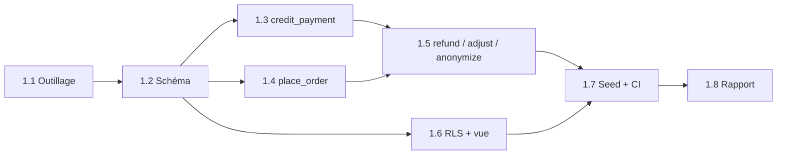

# Phase 1 — Base de données : plan d'exécution

> **Pour l'équipe :** exécuté par le chef de projet avec les sous-agents de `.claude/agents/` selon `TEAM.md`. Circuit de chaque tâche : `lp-tester` → `lp-db` → `lp-coder` (si TypeScript) → `lp-reviewer` ∥ `lp-security` → `lp-reporter`. Cases `- [ ]` pour le suivi. Pas d'écran dans cette phase : ni `lp-designer`, ni `lp-seo`, ni `lp-qa`.

**Objectif :** une base Supabase locale complète (tables, RLS, fonctions SQL d'argent) dont chaque cas d'argent et chaque règle de sécurité est prouvé par un test automatique, rejoué à chaque PR.

**Approche :** tests d'abord. On pose l'outillage (Supabase local, client de test, fabriques), puis le schéma, puis les cinq fonctions d'argent, puis la RLS. Les fonctions sont les seules à modifier `wallets` ; tout le reste est en lecture seule pour le client.

**Documents de référence :** `ROADMAP.md` (Phase 1), `DATA_MODEL.md` (tout), `TESTING.md §2 et §4`, `SECURITY_NOTES.md §5–6`, `LLD.md §1, §4.7`, `CI_CD.md` (étapes 6–7), `ENV_SETUP.md`.

## Décisions à valider par le propriétaire (questions posées avant de coder)

| # | Question | Conseil du chef de projet |
|---|---|---|
| Q1 | Projet Supabase en ligne : le créer maintenant ? | **Non pour l'instant** : tout se fait en local (Docker). On le crée avec lui en phase 3 (comptes). Aucune clé à donner. |
| Q2 | Client de test : `@supabase/supabase-js` seul (déjà autorisé par `LLD.md §1`) ou ajouter `pg` pour annuler chaque test dans une transaction ? | **`supabase-js` seul** : pas de nouvelle bibliothèque. Chaque test crée ses propres faux clients (`client-<n>@lyonpanel.test`) ; `db reset` avant la suite. |
| Q3 | Arrondi du prix SQL : `charged_xaf = ⌈prix_1000 × quantité ÷ 1000 × (1 − remise)⌉` (arrondi au XAF supérieur). OK ? | **Oui** (jamais en dessous du coût). Aligné avec le calcul TypeScript en phase 4 (test « 200 cas »). |
| Q4 | `wallet_transactions` et `audit_log` impossibles à modifier ou effacer, même par le serveur ? | **Oui** : un déclencheur refuse `update`/`delete`. Un journal d'argent doit rester intact. |

Mes choix mineurs (à relire dans le rapport) : fonctions `security definer` avec `search_path` fixé et droit d'exécution **seulement** pour `service_role` ; bucket Storage `ticket-attachments` privé créé par migration ; codes d'erreur SQL en MAJUSCULES (`INSUFFICIENT_BALANCE`…) repris tels quels par l'API plus tard.

## Contraintes globales

- Migrations dans `supabase/migrations/AAAAMMJJHHMMSS_description.sql` ; **jamais** modifier une migration déjà commitée : en ajouter une.
- Montants `bigint` XAF ; aucun `float`. Noms de colonnes exactement ceux de `DATA_MODEL.md`.
- Aucun secret dans le dépôt : les clés locales de `supabase start` restent dans `.env.local`.
- Données de test fictives uniquement (`TESTING.md §4`).
- Code TypeScript en anglais, commentaires et commits en français ; `--no-verify` interdit.
- Branche `feat/phase-1-base-de-donnees`, PR vers `main`.

## Ordre et parallélisme

- **1.1** d'abord, seule. **1.2** ensuite, seule (toutes les tables).
- **1.3, 1.4 et 1.6 en parallèle** : chacune dans son propre fichier de migration et son propre fichier de test (aucun fichier commun).
- **1.5** après 1.3 et 1.4 (réutilise leurs fonctions pour préparer les cas).
- **1.7** puis **1.8** pour finir.

---

### Tâche 1.1 — Outillage de test base de données

- **Objectif :** `supabase start` fonctionne, `npm run test:db` exécute une suite Vitest dédiée contre la base locale.
- **Agents :** `lp-tester` → `lp-coder` → `lp-reviewer` → `lp-reporter`.
- **Fichiers :** `supabase/config.toml` (via `supabase init`), `vitest.db.config.ts`, `tests/db/helpers/client.ts`, `tests/factories/{user,service,payment,order}.ts`, `tests/db/smoke.test.ts` ; `package.json` (scripts `test:db`, `db:types` ; dépendance `@supabase/supabase-js` en version exacte).
- **Interfaces :** `adminClient()` (clé de service), `userClient(userId)` (JWT du client, pour la RLS), `makeUser(overrides?)`, `makeService(overrides?)`, `makePayment(userId, overrides?)`, `makeOrder(...)` — créent des lignes via le client admin, valeurs par défaut modifiables.
- [ ] Étape 1 (lp-tester) : `smoke.test.ts` › `it('se connecte à la base locale et lit settings')` → échoue (rien n'existe).
- [ ] Étape 2 : `supabase init`, `supabase start` ; clés locales dans `.env.local` (jamais commité).
- [ ] Étape 3 : scripts, client de test, fabriques (coquilles typées).
- [ ] Étape 4 : vérifier — lint, types, `npm test` inchangés et verts.
- [ ] Commit : `chore(db): outillage Supabase local et tests de base`.

**Fini quand :** `supabase start` OK, le test smoke devient vert après 1.2, rien d'autre ne casse.

### Tâche 1.2 — Schéma : types, tables, index, contraintes

- **Objectif :** toutes les tables de `DATA_MODEL.md §3` avec leurs contraintes, index (§4) et déclencheurs d'immuabilité.
- **Dépend de :** 1.1. **Agents :** `lp-tester` → `lp-db` → `lp-reviewer` ∥ `lp-security` → `lp-reporter`.
- **Fichiers :** `supabase/migrations/20261107100000_schema.sql`, `tests/db/schema.test.ts`.
- [ ] Étape 1 (lp-tester) `schema.test.ts` : solde négatif refusé ; `amount_xaf = 0` refusé ; `ref` en double refusé ; deux comptes même téléphone refusé ; `min_qty > max_qty` refusé ; 2e `referral_rewards` pour le même filleul refusé ; `update`/`delete` sur `wallet_transactions` et `audit_log` refusés ; un seul `is_admin = true` ; `custom_discount_pct` hors 0–50 refusé ; `profiles` + `wallets` créés automatiquement à la création d'un `auth.users`, `referral_code` de 8 caractères.
- [ ] Étape 2 : échec constaté (tables absentes).
- [ ] Étape 3 (lp-db) : types, tables, index, contraintes, déclencheurs, bucket `ticket-attachments` privé.
- [ ] Étape 4 : `supabase db reset` sans erreur ; tests verts.
- [ ] Commit : `feat(db): schéma complet, index et contraintes`.

**Fini quand :** schéma de `DATA_MODEL.md §3–4` complet, tests verts, `lp-security` ACCEPTÉ.

### Tâche 1.3 — `credit_payment`

- **Dépend de :** 1.2. **Parallèle avec :** 1.4, 1.6. **Agents :** `lp-tester` → `lp-db` → `lp-reviewer` ∥ `lp-security`.
- **Fichiers :** `supabase/migrations/20261107110000_credit_payment.sql`, `tests/db/credit-payment.test.ts`.
- **Interface (mon choix) :** `credit_payment(p_payment_id uuid, p_saspay_transaction_id text, p_net_amount_xaf bigint, p_fee_xaf bigint, p_total_paid bigint, p_network text, p_raw jsonb) returns jsonb` → `{ credited, balance_xaf, referral_bonus_xaf }`.
- [ ] Étape 1 (lp-tester), cas de `TESTING.md §2` : crédit normal (solde, transaction `recharge`, `ref = pay:<id>`, `total_recharged_xaf`) ; même appel 2 fois = 1 seul crédit ; 2 appels **en parallèle** = 1 crédit ; montant ≠ demandé → `AMOUNT_MISMATCH`, aucun crédit ; paiement inconnu → `PAYMENT_NOT_FOUND` ; 1re recharge d'un filleul → bonus parrain 5 % arrondi à l'inférieur (3 000 → 150 ; 10 000 → 500), **une seule fois** ; seuil 50 000 franchi (remise auto lisible via `total_recharged_xaf`) ; compte supprimé → crédit + `audit_log` « à rembourser » ; même identifiant SasPay sur un autre paiement refusé.
- [ ] Étapes 2–4 : échec → implémentation (verrou `for update` sur paiement et portefeuille) → vert.
- [ ] Commit : `feat(db): créditer un paiement une seule fois`.

### Tâche 1.4 — `place_order`

- **Dépend de :** 1.2. **Parallèle avec :** 1.3, 1.6. **Agents :** idem 1.3.
- **Fichiers :** `supabase/migrations/20261107120000_place_order.sql`, `tests/db/place-order.test.ts`.
- **Interface :** `place_order(p_user uuid, p_service int, p_link text, p_qty int, p_comments text[], p_idem_key text, p_expected_price_xaf_1000 bigint default null) returns orders` ; erreurs : `INSUFFICIENT_BALANCE`, `ACCOUNT_BLOCKED`, `SERVICE_UNAVAILABLE`, `QUANTITY_OUT_OF_RANGE`, `PRICE_CHANGED`, `DAILY_LIMIT_REACHED`.
- **Règle de prix (voir Q3) :** remise = max(remise auto 10 % si `total_recharged_xaf` ≥ seuil, `custom_discount_pct`), jamais cumulées ; `charged_xaf` arrondi au XAF supérieur ; `cost_usd` estimé.
- [ ] Étape 1 (lp-tester) : solde suffisant → débit exact + transaction `order` + commande `pending` ; solde insuffisant ; client bloqué ; service inactif ou indisponible ; quantité sous min / au-dessus de max / non ronde (137) ; même `idem_key` 2 fois = 1 commande, 1 débit ; **2 commandes en parallèle dépassant le solde = une seule passe** ; solde jamais négatif ; prix changé → `PRICE_CHANGED` sans débit ; plafond 500 000 XAF / 24 h → `DAILY_LIMIT_REACHED` ; remise auto, remise perso plus grande / plus petite, non cumulées ; aucun montant fourni par l'appelant n'est utilisé.
- [ ] Étapes 2–4 : échec → implémentation (verrou portefeuille) → vert.
- [ ] Commit : `feat(db): passer une commande et débiter le solde atomiquement`.

### Tâche 1.5 — `refund_order`, `admin_adjust`, `anonymize_user`

- **Dépend de :** 1.3, 1.4. **Agents :** `lp-tester` → `lp-db` → `lp-reviewer` ∥ `lp-security`.
- **Fichiers :** `supabase/migrations/20261107130000_admin_functions.sql`, `tests/db/refund-order.test.ts`, `admin-adjust.test.ts`, `anonymize-user.test.ts`.
- **Interfaces :** `refund_order(p_order uuid, p_amount bigint, p_admin uuid) returns orders` (`ALREADY_REFUNDED`, `AMOUNT_TOO_HIGH`, `NOT_ADMIN`) ; `admin_adjust(p_user uuid, p_amount bigint, p_note text, p_admin uuid)` (note obligatoire, solde jamais négatif) ; `anonymize_user(p_user uuid)`.
- [ ] Étape 1 (lp-tester) : remboursement total ; partiel ; double remboursement refusé ; montant > débité refusé ; `audit_log` écrit ; non-admin refusé ; ajustement positif / négatif ; ajustement rendant le solde négatif refusé ; sans note refusé ; anonymisation : email, téléphone, messages effacés, `status='deleted'`, favoris et pièces jointes supprimés, **commandes et paiements gardés**, 2e appel sans effet.
- [ ] Étapes 2–4 : échec → implémentation → vert.
- [ ] Commit : `feat(db): remboursement, ajustement et anonymisation`.

### Tâche 1.6 — RLS et vue `services_public`

- **Dépend de :** 1.2. **Parallèle avec :** 1.3, 1.4. **Agents :** `lp-tester` → `lp-db` → `lp-reviewer` ∥ `lp-security`.
- **Fichiers :** `supabase/migrations/20261107140000_rls.sql`, `tests/db/rls.test.ts`.
- [ ] Étape 1 (lp-tester), avec deux clients A et B et un admin : A ne lit ni commandes, ni solde, ni transactions, ni paiements, ni tickets, ni favoris de B, mais lit les siens ; A ne peut rien écrire dans `wallets`, `wallet_transactions`, `payments`, `orders` ; A modifie son `language` mais **pas** `status`, `is_admin`, `custom_discount_pct`, `referred_by` ; A ne lit jamais `admin_notes`, `settings`, `audit_log`, `referral_rewards`, `service_price_history`, `jap_balance_snapshots`, `login_attempts`, `rate_limits`, `allowed_signups`, `idempotency_keys` ; `services_public` sans `jap_name`, `cost_usd_1000`, `margin_pct`, seulement services actifs et disponibles, et `services` illisible directement ; l'admin lit tout ; un client ne peut pas appeler les cinq fonctions d'argent ; le visiteur anonyme ne lit rien ; un client ne voit que ses pièces jointes dans Storage.
- [ ] Étapes 2–4 : échec → implémentation → vert.
- [ ] Commit : `feat(db): sécurité des lignes et vue publique des services`.

### Tâche 1.7 — Seed, types TypeScript, CI

- **Dépend de :** 1.3, 1.4, 1.5, 1.6. **Agents :** `lp-tester` → `lp-db` + `lp-coder` → `lp-reviewer` ∥ `lp-security`.
- **Fichiers :** `supabase/seed.sql`, `src/server/db/types.ts` (généré, jamais édité à la main), `.github/workflows/ci.yml` (étapes 6–7 de `CI_CD.md §3`), `tests/db/seed.test.ts`.
- [ ] Test : les réglages par défaut existent avec les bonnes valeurs ; ~20 services fictifs (TikTok, Instagram, Facebook), une moitié active, prix inventés, aucun vrai nom JAP.
- [ ] `seed.sql` (réglages de `DATA_MODEL.md §3`, aucune vraie donnée) ; `npm run db:types` ; CI : `supabase start` → `supabase db reset` → `npm run test:db` (bloquant).
- [ ] Matrice : chaque ligne du tableau « cas d'argent » de `TESTING.md §2` associée à un test nommé (dans le rapport).
- [ ] Commit : `feat(db): seed, types générés et étape base dans la CI`.

### Tâche 1.8 — Rapport

- **Dépend de :** 1.1–1.7 acceptées. **Agent :** `lp-reporter`.
- [ ] `docs/reports/phase-1/` (un rapport par tâche + `BILAN.md` avec la matrice des cas d'argent) ; tableau de bord ; notes Obsidian ; `graphify update .` ; `CHANGELOG`.
- [ ] `ROADMAP.md` « Suivi » : Phase 1 → `faite – en attente de validation`. **Jamais « validée »** (seul le propriétaire).
- [ ] Le chef de projet ouvre la PR vers `main` et vérifie la CI.

## Ce que le propriétaire testera à la fin

1. Sur GitHub : la PR, CI verte (nouvelle étape « base de données »).
2. En local : Docker lancé, `supabase start`, `npm run test:db` → tout vert ; `supabase db reset` sans erreur.
3. (Facultatif) Ouvrir Supabase Studio local (http://127.0.0.1:54323) et regarder les tables.
4. Répondre « validé » pour passer à la Phase 2.
