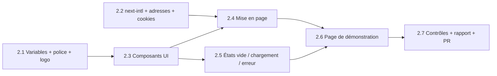

# Phase 2 — Design system + mise en page : plan d'exécution

> **Pour l'équipe :** exécuté par le chef de projet avec les sous-agents de `.claude/agents/` selon `TEAM.md`. Circuit : `lp-tester` → `lp-coder` → `lp-designer` ∥ `lp-seo` → `lp-reviewer` ∥ `lp-qa` → `lp-reporter`. Pas de base de données (`lp-db` absent) ni d'argent (`lp-security` absent). Cases `- [ ]` pour le suivi.

**Statut : plan en attente d'accord du propriétaire (questions Q1 à Q6). Rien n'est codé.**

**Objectif :** un socle visuel et de navigation prêt à recevoir les écrans des phases 3 à 14 : couleurs et police du design system, six composants de base, FR/EN avec adresses traduites, langue et devise mémorisées, en-tête, pied de page, barre latérale, états vide/chargement/erreur, logo et favicon. Une page de démonstration prouve le tout en FR et EN, sur téléphone et ordinateur.

**Approche :** les règles de `docs/05` sont écrites une seule fois (variables CSS + Tailwind), puis chaque composant les réutilise. Tests d'abord pour la logique (routage, cookies, formatage de devise) ; les composants sont testés par Testing Library (rendu, clavier, états) puis contrôlés dans un vrai navigateur par `lp-qa`.

**Documents de référence :** `ROADMAP.md` (Phase 2), `docs/05-design-system.md` (tout, dont §9 et les 7 images), `LLD.md §0, §1, §6`, `docs/03 §3 ter, §5`, `CONVENTIONS.md`, `TESTING.md`.

## Décisions à valider par le propriétaire (questions posées avant de coder)

| # | Question | Conseil du chef de projet |
|---|---|---|
| Q1 | Quelles devises dans le sélecteur ? | **XAF, XOF, USD** (comme prévu en phase 4). Choix gardé dans un cookie, même sans compte. En phase 2, l'affichage convertit avec un **taux fictif de démonstration** ; le vrai taux vient en phase 4. |
| Q2 | La page de démonstration : où, et que devient-elle ? | **`/fr/demo` et `/en/demo`**, `noindex`, jamais dans le sitemap, **supprimée avant la mise en ligne** (phase 13). Textes d'exemple clairement fictifs, aucun faux chiffre ni faux avis. |
| Q3 | Barre latérale : les pages pas encore faites (Commandes, Recharger…) ? | **Menu complet** comme `docs/05 §9`, et chaque page non faite affiche un écran « Bientôt disponible » (état vide). Ainsi on teste toute la navigation dès maintenant. |
| Q4 | Animations GSAP et Lenis dans cette phase ? | **Non.** Seulement des transitions CSS de 150–250 ms. GSAP/Lenis arrivent en phase 14 (accueil) : moins de poids sur petit téléphone. |
| Q5 | Police Public Sans : comment la charger ? | **Auto-hébergée par Next.js (`next/font`)** : aucun appel à Google à chaque visite, plus rapide, meilleur pour la vie privée. |
| Q6 | Composants shadcn : comment les obtenir sans nouvelle bibliothèque ? | **Je les écris à la main dans `src/components/ui/`** à partir de Radix (`dialog`, `slot`), `clsx`, `tailwind-merge`, `lucide-react` — tous dans `LLD.md §1`. Je **n'utilise pas `class-variance-authority`** (absent de la liste) : variantes écrites simplement. `@testing-library/react` (déjà dans la liste) pour les tests. Aucune demande d'ajout. |

Mes choix mineurs (à relire dans le rapport) : barre du bas = Commander, Commandes, Recharger, Compte (`docs/05 §9`) ; pas de mode sombre (`LLD §0 #6`) ; `<html lang>` selon la langue ; cookies `NEXT_LOCALE` et `NEXT_CURRENCY` en `SameSite=Lax`, sans donnée personnelle.

## Contraintes globales

- Couleurs, rayons, espacements, tailles : **uniquement** les valeurs de `docs/05` (jamais de couleur en dur dans un composant). Jaune 700 pour du texte jaune.
- Aucune phrase en dur : tout texte vient de `src/messages/{fr,en}.json` (clés par écran). Les deux fichiers ont les mêmes clés (test).
- Bouton : hauteur min 44 px, désactivé + « Chargement… » après clic.
- Code en anglais, commentaires et commits en français ; `--no-verify` interdit ; pas de `any`, ni `dangerouslySetInnerHTML`, ni `useEffect` pour charger des données.
- Aucune migration, aucun module métier touché. Branche `feat/phase-2-design-system`, PR vers `main`.
- Next.js 16 : le fichier de routage de langue s'appelle `proxy.ts` (ex-`middleware.ts`) ; vérifier dans la doc de `next-intl` avant d'écrire.

## Ordre et parallélisme

- **2.1 et 2.2 en parallèle** (fichiers distincts : styles/police/assets contre i18n/routing).
- **2.3 après 2.1** ; **2.4 après 2.2 et 2.3** ; **2.5 après 2.3** (peut tourner avec 2.4 : fichiers distincts).
- **2.6** puis **2.7** pour finir.

---

### Tâche 2.1 — Variables, police, logo, favicon

- **Objectif :** `docs/05 §8` en variables CSS + thème Tailwind ; Public Sans (400/600/700) ; logo et icônes de `brand/lyonpanel-v2/`.
- **Agents :** `lp-tester` → `lp-coder` → `lp-designer` → `lp-reviewer` → `lp-reporter`.
- **Fichiers :** `src/styles/globals.css`, `src/app/[locale]/layout.tsx` (police), `src/components/shared/logo.tsx`, `public/brand/*`, `src/app/icon.*`, `apple-icon.png`, `manifest.ts`, `tests/unit/design-tokens.test.ts`.
- [ ] Étape 1 (lp-tester) : chaque variable de `docs/05 §8` existe dans `globals.css` avec la bonne valeur ; composant `Logo` (variantes horizontal / icône, `alt` présent).
- [ ] Étape 2 : variables + thème, police `next/font`, logo, favicon, manifeste.
- [ ] Étape 3 : `lp-designer` : titres 28/40, 22/28, 18/20, interligne, `tabular-nums` pour les prix.
- [ ] Commit : `feat(design): variables, police Public Sans, logo et favicon`.

**Fini quand :** les variables correspondent à `docs/05`, la police s'affiche sans appel externe, favicon visible.

### Tâche 2.2 — Langues, adresses traduites, cookies

- **Objectif :** `/fr/commander` ↔ `/en/order` etc. (`LLD §6`), langue du navigateur au premier passage, choix gardé, devise gardée.
- **Agents :** `lp-tester` → `lp-coder` → `lp-reviewer` → `lp-reporter`.
- **Fichiers :** `src/i18n/{routing,request,navigation}.ts`, `src/proxy.ts`, `src/messages/{fr,en}.json`, `src/lib/currency.ts`, `next.config.ts`, `tests/unit/{routing,locale-detection,currency}.test.ts`.
- [ ] Étape 1 (lp-tester) : les 14 adresses de `LLD §6` (fr et en) ; `Accept-Language` fr/en/autre → fr ; cookie `NEXT_LOCALE` prioritaire ; devise inconnue → XAF ; formatage XAF entier sans décimales ; mêmes clés dans `fr.json` et `en.json`.
- [ ] Étape 2 : routage, détection, cookies, messages de base.
- [ ] Étape 3 : `hreflang` fr/en + `x-default` → fr dans les métadonnées de base.
- [ ] Commit : `feat(i18n): next-intl, adresses traduites, langue et devise en cookies`.

**Fini quand :** tests verts et `/` envoie vers `/fr` ou `/en` correctement.

### Tâche 2.3 — Composants de base

- **Objectif :** bouton (principal, secondaire, discret, danger), champ (libellé, erreur, aide), carte, badge (statuts + « Populaire »), tableau (cartes sur mobile), dialogue.
- **Dépend de :** 2.1. **Agents :** `lp-tester` → `lp-coder` (jusqu'à 3 en parallèle : bouton+champ / carte+badge / tableau+dialogue) → `lp-designer` → `lp-reviewer` ∥ `lp-qa` → `lp-reporter`.
- **Fichiers :** `src/components/ui/{button,input,field,card,badge,table,dialog}.tsx`, `src/lib/cn.ts`, `tests/unit/ui/*.test.tsx`.
- [ ] Étape 1 (lp-tester) : bouton désactivé + « Chargement… » après clic, hauteur ≥ 44 px, focus visible ; champ : libellé lié, erreur annoncée (`aria-describedby`) ; badge : 4 statuts aux bonnes couleurs ; dialogue : Échap ferme, focus piégé et rendu ; tableau : chiffres à droite.
- [ ] Étape 2 : composants (variantes simples, sans `cva`).
- [ ] Étape 3 : `lp-designer` + `antislop-ui` : une seule ombre, rayons 8/12 px, cartes non toutes identiques.
- [ ] Commit : `feat(ui): bouton, champ, carte, badge, tableau, dialogue`.

**Fini quand :** les 6 composants respectent `docs/05 §4`, tests verts, accessibles au clavier.

### Tâche 2.4 — Mise en page : en-tête, pied de page, barre latérale

- **Objectif :** en-tête public (Accueil, Services, Blog, Connexion, Inscription) avec choix de langue et de devise ; pied de page (confidentialité, conditions, contact) ; gabarit « espace client » : barre latérale à gauche (ordinateur), menu du bas (téléphone), solde en haut à droite (valeur fictive en démo).
- **Dépend de :** 2.2, 2.3. **Agents :** `lp-tester` → `lp-coder` → `lp-designer` → `lp-reviewer` ∥ `lp-qa` → `lp-reporter`.
- **Fichiers :** `src/components/layout/{site-header,site-footer,sidebar,bottom-nav,language-switcher,currency-switcher}.tsx`, `src/app/[locale]/(public)/layout.tsx`, `src/app/[locale]/(app)/layout.tsx`, `tests/unit/layout/*.test.tsx`.
- [ ] Étape 1 (lp-tester) : changer de langue garde la page équivalente (`/fr/commander` → `/en/order`) ; changer de devise pose le cookie ; lien actif (`aria-current`) ; menu du bas : 4 entrées ; textes depuis les messages.
- [ ] Étape 2 : composants et deux gabarits.
- [ ] Étape 3 : `lp-designer` : règles de `docs/05 §9` (1 et 5), téléphone d'abord.
- [ ] Commit : `feat(layout): en-tête, pied de page, barre latérale et menu du bas`.

**Fini quand :** navigation complète FR/EN, bascule de langue conserve la page, menu du bas sur 360 px.

### Tâche 2.5 — États vide, chargement, erreur

- **Objectif :** `EmptyState`, chargement (squelettes), `ErrorState` avec « Réessayer », page « Bientôt disponible », `not-found` / `error` / `loading` localisés.
- **Dépend de :** 2.3 (avec 2.4 possible). **Agents :** `lp-tester` → `lp-coder` → `lp-designer` → `lp-reviewer` → `lp-reporter`.
- **Fichiers :** `src/components/shared/{empty-state,loading-state,error-state}.tsx`, `src/app/[locale]/{not-found,error,loading}.tsx`, `tests/unit/shared/*.test.tsx`.
- [ ] Étape 1 (lp-tester) : `role="status"` (chargement), `role="alert"` (erreur) ; « Réessayer » appelle `reset` ; textes FR/EN.
- [ ] Étape 2 : écrire. Étape 3 : `lp-designer` + `antislop-copywriting` (phrases concrètes, pas de « Oups ! »).
- [ ] Commit : `feat(ui): états vide, chargement et erreur`.

**Fini quand :** les trois états existent en FR et EN, testés.

### Tâche 2.6 — Page de démonstration FR + EN

- **Objectif :** `/fr/demo` et `/en/demo` montrent tous les composants et états dans les deux gabarits, `noindex`.
- **Dépend de :** 2.4, 2.5. **Agents :** `lp-tester` → `lp-coder` → `lp-designer` ∥ `lp-seo` → `lp-reviewer` ∥ `lp-qa` → `lp-reporter`.
- **Fichiers :** `src/app/[locale]/(public)/demo/page.tsx`, `src/messages/*.json`, `tests/e2e/demo.spec.ts`.
- [ ] Étape 1 (lp-tester) : Playwright : page en FR et EN, 360 px sans défilement horizontal, `noindex`, absente du sitemap.
- [ ] Étape 2 : page ; `lp-seo` : `noindex`, `hreflang` ; `lp-designer` règle l'ensemble.
- [ ] Commit : `feat(demo): page de démonstration des composants FR/EN`.

**Fini quand :** tout est visible en FR et EN, téléphone et ordinateur.

### Tâche 2.7 — Contrôles finaux, rapport, PR

- **Agents :** `lp-reviewer` ∥ `lp-qa` (360 px réseau lent, 1280 px ; clavier ; console propre) → corrections → `lp-reporter`.
- [ ] Skills : `baseline-ui`, `antislop-ui`, `antislop-layoutmobile`, `antislop-copywriting`, `fixing-accessibility`, `ponytail-review`, `ecc:code-review`.
- [ ] `npm run lint`, `typecheck`, `test`, `build`, `test:e2e` verts, résultats montrés.
- [ ] Rapport `docs/reports/phase-2/`, bilan, `ROADMAP.md` Suivi → « à valider », PR, CI verte.
- [ ] Résumé au propriétaire en français simple. **Il écrit « validé » ; sinon la Phase 3 ne démarre pas.**

**Fini quand :** critères de `CLAUDE.md` (« Terminé quand ») tous cochés et PR verte.
