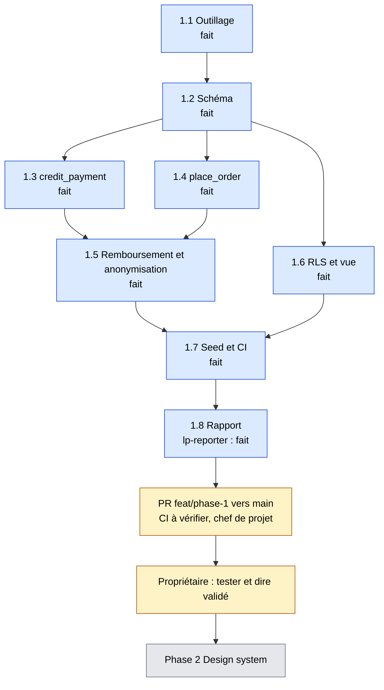

# Tableau de bord LyonPanel
Mis à jour le 2026-11-07 (fin de la phase 1). Chiffres lus dans les comptes-rendus de la phase 1 et les commandes lancées.

**En 5 secondes :** la phase 0 est validée. La phase 1 (base de données) est faite, en attente de ton « validé ». Rien ne bloque côté technique. Reste à vérifier : la CI GitHub sur la PR. Ensuite : phase 2, design system.

## 1. Avancement des phases
Bleu : validée. Jaune : faite, en attente de validation. Gris : à faire. Seules les phases 0 et 1 ont une date réelle (2026-11-07).

```mermaid
flowchart LR
  P0["Phase 0 Socle<br/>validée<br/>2026-11-07"] --> P1["Phase 1 Base de données<br/>faite, en attente<br/>2026-11-07"]
  P1 --> P2["2 Design system"]
  P2 --> P3["3 Comptes"]
  P3 --> P4["4 Prix et catalogue"]
  P4 --> P5["5 Recharge SasPay"]
  P5 --> P6["6 Commande"]
  P6 --> P7["7 Suivi et alertes"]
  P7 --> P8["8 Espace client"]
  P8 --> P9["9 Support"]
  P9 --> P10["10 Parrainage"]
  P10 --> P11["11 Admin 1"]
  P11 --> P12["12 Admin 2"]
  P12 --> P13["13 Mise en ligne de test"]
  P13 --> P14["14 Accueil et SEO"]
  P14 --> P15["15 Vrai JAP"]
  P15 --> P16["16 Ouverture publique"]
  classDef valide fill:#DBEAFE,stroke:#1D4ED8,color:#000
  classDef enattente fill:#FEF3C7,stroke:#B45309,color:#000
  classDef afaire fill:#E5E7EB,stroke:#6B7280,color:#000
  class P0 valide
  class P1 enattente
  class P2,P3,P4,P5,P6,P7,P8,P9,P10,P11,P12,P13,P14,P15,P16 afaire
```

## 2. Tâches de la phase 1 (tableau Kanban)

```mermaid
flowchart LR
  subgraph A["À faire"]
    direction TB
    a0["aucune"]
  end
  subgraph B["Tests écrits"]
    direction TB
    b0["aucune"]
  end
  subgraph C["Codée"]
    direction TB
    c0["aucune"]
  end
  subgraph D["Contrôles"]
    direction TB
    d0["aucune"]
  end
  subgraph E["À corriger"]
    direction TB
    e0["aucune"]
  end
  subgraph F["Acceptée"]
    direction TB
    f0["aucune"]
  end
  subgraph G["Rapportée"]
    direction TB
    g1["1.1 Outillage"]
    g2["1.2 Schéma"]
    g3["1.3 credit_payment"]
    g4["1.4 place_order"]
    g5["1.5 Remboursement, ajustement, anonymisation"]
    g6["1.6 RLS et vue"]
    g7["1.7 Seed, types, CI"]
    g8["Durcissement sécurité"]
    g9["1.8 Rapport et bilan"]
  end
  A --> B --> C --> D --> E --> F --> G
  classDef fait fill:#DBEAFE,stroke:#1D4ED8,color:#000
  classDef vide fill:#F3F4F6,stroke:#9CA3AF,color:#6B7280
  class g1,g2,g3,g4,g5,g6,g7,g8,g9 fait
  class a0,b0,c0,d0,e0,f0 vide
```

## 3. Répartition des tâches de la phase 1

Le durcissement sécurité est compté comme une tâche à part.

## 4. Qui fait quoi maintenant
Aucun agent n'est actif. Reste la PR (chef de projet) puis le propriétaire.

## 5. Santé du projet
| Phase | Tests (écrits) | Tests verts | Couverture modules d'argent | Corrections demandées par les contrôles |
|---|---|---|---|---|
| 0 | 29 (28 Vitest + 1 Playwright) | 29 | sans objet (aucun module d'argent) | 2 correctifs après audit sécurité |
| 1 | 253 (225 base de données + 28 Vitest) | 253 | Chaque cas d'argent de `TESTING.md §2` a un test nommé (matrice du bilan). Pas de pourcentage de lignes SQL. | 2 failles moyennes corrigées, 1 fuite de colonnes corrigée, 1 paiement `failed` corrigé |

Les 29 tests de la phase 0 incluent 1 test Playwright, non relancé en phase 1. Les 28 tests Vitest ont été relancés (verts).

```mermaid
xychart-beta
  title "Tests par phase"
  x-axis ["Phase 0", "Phase 1"]
  y-axis "Nombre de tests" 0 --> 260
  bar [29, 253]
  bar [29, 253]
```

Première barre : tests écrits. Deuxième barre : tests verts.
