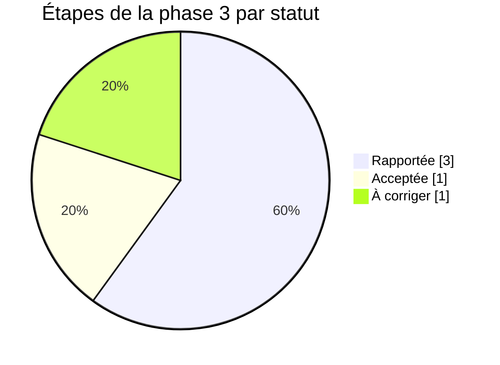
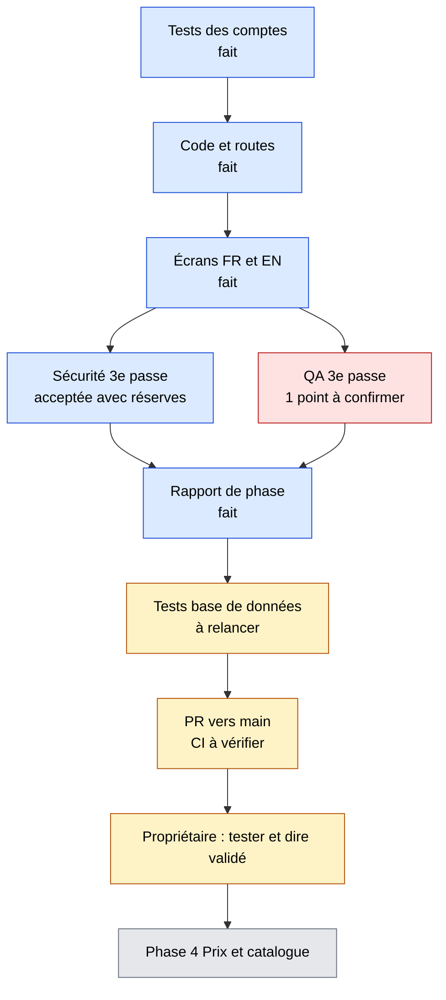

# Tableau de bord LyonPanel
Mis à jour le 2026-11-08 (fin de la phase 3). Chiffres lus dans les comptes-rendus des phases 1 à 3.

**En 5 secondes :** les phases 0, 1 et 2 sont validées. La phase 3 (comptes) est faite, en attente de ton « validé ». Points ouverts : tests de base de données pas relancés dans le dernier état, le problème QA « session coupée = page d'erreur » corrigé et vérifié par le développeur, CI GitHub pas encore passée sur la PR. Ensuite : phase 4, prix et catalogue.

## 1. Avancement des phases
Bleu : validée. Jaune : faite, en attente de validation. Gris : à faire. Dates réelles : phases 0 et 1 le 2026-11-07, phase 2 le 2026-11-08, phase 3 faite le 2026-11-08.

```mermaid
flowchart LR
  P0["Phase 0 Socle<br/>validée<br/>2026-11-07"] --> P1["Phase 1 Base de données<br/>validée<br/>2026-11-07"]
  P1 --> P2["Phase 2 Design system<br/>validée<br/>2026-11-08"]
  P2 --> P3["Phase 3 Comptes<br/>faite, en attente<br/>2026-11-08"]
  P3 --> P4["4 Prix et catalogue"]
  P4 --> P5["5 Recharge SasPay"]
  P5 --> P6["6 Commande"]
  P6 --> P7["7 Suivi et alertes"]
  P7 --> P8["8 Espace client"]
  P8 --> P9["9 Support"]
  P9 --> P10["10 Parrainage"]
  P10 --> P11["11 Admin 1"]
  P11 --> P12["12 Admin 2"]
  P12 --> P13["13 Mise en ligne de test"]
  P13 --> P14["14 Accueil et SEO"]
  P14 --> P15["15 Vrai JAP"]
  P15 --> P16["16 Ouverture publique"]
  classDef valide fill:#DBEAFE,stroke:#1D4ED8,color:#000
  classDef enattente fill:#FEF3C7,stroke:#B45309,color:#000
  classDef afaire fill:#E5E7EB,stroke:#6B7280,color:#000
  class P0,P1,P2 valide
  class P3 enattente
  class P4,P5,P6,P7,P8,P9,P10,P11,P12,P13,P14,P15,P16 afaire
```

## 2. Étapes de la phase 3 (tableau Kanban)
La phase 3 n'est pas découpée en tâches numérotées : le plan la découpe en 6 étapes (tests, base, code, design et SEO, contrôles, rapport).

```mermaid
flowchart LR
  subgraph A["À faire"]
    direction TB
    a0["aucune"]
  end
  subgraph B["Tests écrits"]
    direction TB
    b0["aucune"]
  end
  subgraph C["Codée"]
    direction TB
    c0["aucune"]
  end
  subgraph D["Contrôles"]
    direction TB
    d0["aucune"]
  end
  subgraph E["À corriger"]
    direction TB
    e1["Session coupée : page d erreur, à confirmer"]
  end
  subgraph F["Acceptée"]
    direction TB
    f1["Sécurité : acceptée avec réserves"]
  end
  subgraph G["Rapportée"]
    direction TB
    g1["Tests et code des comptes"]
    g2["Écrans FR et EN"]
    g3["Rapport de phase"]
  end
  A --> B --> C --> D --> E --> F --> G
  classDef fait fill:#DBEAFE,stroke:#1D4ED8,color:#000
  classDef encours fill:#FEF3C7,stroke:#B45309,color:#000
  classDef bloque fill:#FEE2E2,stroke:#B91C1C,color:#000
  classDef vide fill:#F3F4F6,stroke:#9CA3AF,color:#6B7280
  class g1,g2,g3,f1 fait
  class e1 bloque
  class a0,b0,c0,d0 vide
```

## 3. Répartition des étapes de la phase 3

## 4. Qui fait quoi maintenant
Aucun agent n'est actif. Reste : confirmer le point QA, relancer les tests de base de données, ouvrir la PR et vérifier la CI (chef de projet), puis le propriétaire.

## 5. Santé du projet
| Phase | Tests écrits | Tests verts | Couverture modules d'argent | Corrections demandées par les contrôles |
|---|---|---|---|---|
| 0 | 29 (28 Vitest + 1 Playwright) | 29 | sans objet | 2 correctifs après audit sécurité |
| 1 | 253 (225 base + 28 Vitest) | 253 | un test nommé par cas d'argent, pas de pourcentage | 2 failles moyennes, 1 fuite de colonnes, 1 paiement failed, tous corrigés |
| 2 | 270 (247 Vitest + 23 Playwright) | 270 | sans objet (aucun module d'argent) | 2 verdicts À CORRIGER (relecture, QA), corrigés |
| 3 | 457 (439 Vitest + 18 Playwright) | 457 (tests de base non relancés) | sans objet (aucun module d'argent) | sécurité : 2 passes À CORRIGER puis acceptée avec réserves ; QA : 2 passes À CORRIGER, 1 point restant à confirmer |

Lire chaque ligne comme « état de la phase », pas comme un cumul : les suites des phases précédentes sont comptées de nouveau. Les 225 tests de la base (phase 1) ne sont pas dans la ligne de la phase 3 car ils n'ont pas été relancés dans le dernier état.

Performance de la démo (LCP médian, téléphone lent, build de production) : 5,85 s avant, 2,37 s après (phase 2).

```mermaid
xychart-beta
  title "Tests par phase"
  x-axis ["Phase 0", "Phase 1", "Phase 2", "Phase 3"]
  y-axis "Nombre de tests" 0 --> 500
  bar [29, 253, 270, 457]
  bar [29, 253, 270, 457]
```

Première barre : tests écrits. Deuxième barre : tests verts. Phase 3 : Vitest et Playwright seulement.
