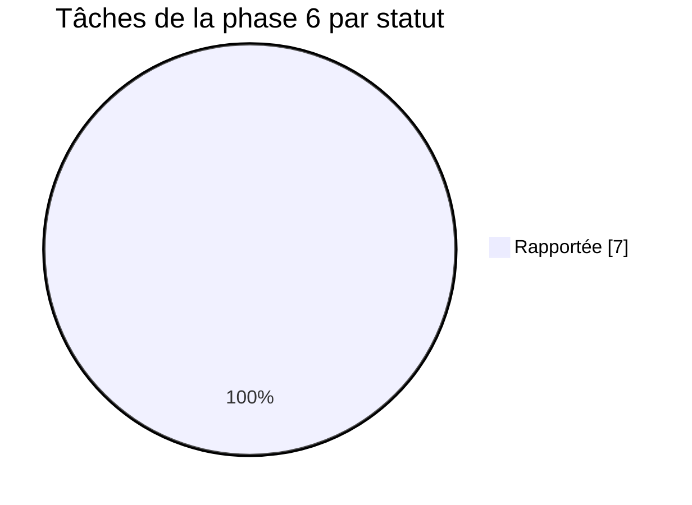
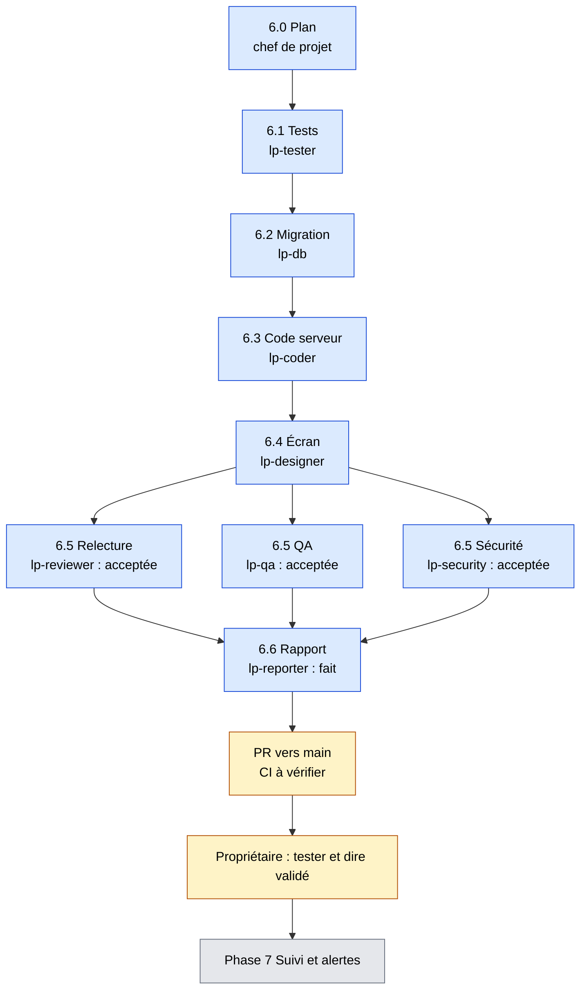

# Tableau de bord LyonPanel
Mis à jour le 2026-11-10 (phase 6 faite). Chiffres lus dans les comptes-rendus des phases 1 à 6.

**En 5 secondes :** les phases 0 à 5 sont validées. La phase 6 (commande avec le faux fournisseur) est faite et attend ta validation. Rien ne bloque, sauf la CI GitHub à lire sur la PR. Ensuite : phase 7, suivi et alertes (le bot Telegram est à créer par toi).

## 1. Avancement des phases
Bleu : validée. Jaune : faite, en attente de validation. Gris : à faire. Dates réelles : phases 0 et 1 le 2026-11-07, phase 2 le 2026-11-08, phase 3 le 2026-11-09, phase 4 le 2026-11-10. Phase 5 validée le 2026-11-10. Phase 6 faite le 2026-11-10, pas encore validée.

```mermaid
flowchart LR
  P0["Phase 0 Socle<br/>validée<br/>2026-11-07"] --> P1["Phase 1 Base de données<br/>validée<br/>2026-11-07"]
  P1 --> P2["Phase 2 Design system<br/>validée<br/>2026-11-08"]
  P2 --> P3["Phase 3 Comptes<br/>validée<br/>2026-11-09"]
  P3 --> P4["Phase 4 Prix et catalogue<br/>validée<br/>2026-11-10"]
  P4 --> P5["Phase 5 Recharge SasPay<br/>validée<br/>2026-11-10"]
  P5 --> P6["Phase 6 Commande<br/>faite, attend validation<br/>2026-11-10"]
  P6 --> P7["7 Suivi et alertes"]
  P7 --> P8["8 Espace client"]
  P8 --> P9["9 Support"]
  P9 --> P10["10 Parrainage"]
  P10 --> P11["11 Admin 1"]
  P11 --> P12["12 Admin 2"]
  P12 --> P13["13 Mise en ligne de test"]
  P13 --> P14["14 Accueil et SEO"]
  P14 --> P15["15 Vrai fournisseur"]
  P15 --> P16["16 Ouverture publique"]
  classDef valide fill:#DBEAFE,stroke:#1D4ED8,color:#000
  classDef enattente fill:#FEF3C7,stroke:#B45309,color:#000
  classDef afaire fill:#E5E7EB,stroke:#6B7280,color:#000
  class P0,P1,P2,P3,P4,P5 valide
  class P6 enattente
  class P7,P8,P9,P10,P11,P12,P13,P14,P15,P16 afaire
```

## 2. Tâches de la phase 6 (tableau Kanban)

```mermaid
flowchart LR
  subgraph A["À faire"]
    direction TB
    a0["aucune"]
  end
  subgraph B["Tests écrits"]
    direction TB
    b0["aucune"]
  end
  subgraph C["Codée"]
    direction TB
    c0["aucune"]
  end
  subgraph D["Contrôles"]
    direction TB
    d0["aucune"]
  end
  subgraph E["À corriger"]
    direction TB
    e0["aucune"]
  end
  subgraph F["Acceptée"]
    direction TB
    f0["aucune"]
  end
  subgraph G["Rapportée"]
    direction TB
    g0["6.0 Plan"]
    g1["6.1 Tests"]
    g2["6.2 Migration"]
    g3["6.3 Code serveur"]
    g4["6.4 Écran de commande"]
    g5["6.5 Contrôles"]
    g6["6.6 Rapport et bilan"]
  end
  A --> B --> C --> D --> E --> F --> G
  classDef fait fill:#DBEAFE,stroke:#1D4ED8,color:#000
  classDef vide fill:#F3F4F6,stroke:#9CA3AF,color:#6B7280
  class g0,g1,g2,g3,g4,g5,g6 fait
  class a0,b0,c0,d0,e0,f0 vide
```

## 3. Répartition des tâches de la phase 6

## 4. Qui fait quoi maintenant
Plus aucun agent actif. Le chef de projet lit la CI sur la PR, puis le propriétaire teste et dit « validé ».

## 5. Santé du projet
| Phase | Tests écrits | Tests verts | Couverture modules d'argent | Corrections demandées par les contrôles |
|---|---|---|---|---|
| 0 | 29 (28 Vitest + 1 Playwright) | 29 | sans objet | 2 correctifs après audit sécurité |
| 1 | 253 (225 base + 28 Vitest) | 253 | un test nommé par cas d'argent, pas de pourcentage | 2 failles moyennes, 1 fuite de colonnes, 1 paiement failed, tous corrigés |
| 2 | 270 (247 Vitest + 23 Playwright) | 270 | sans objet (aucun module d'argent) | 2 verdicts À CORRIGER (relecture, QA), corrigés |
| 3 | 543 (488 Vitest + 55 Playwright) | 543 (tests de base non relancés) | sans objet (aucun module d'argent) | sécurité : 2 passes À CORRIGER puis acceptée avec réserves ; QA : plusieurs passes, 2 points importants alors en correction |
| 4 | 1 048 Vitest + 13 Playwright (catalogue) + 278 base | 1 048 Vitest, 13 Playwright, 273 base (5 échecs : stockage de fichiers, conteneur arrêté) | calcul des prix testé (pas de pourcentage mesuré dans les comptes-rendus) | sécurité : 2 remarques corrigées ; QA : 1 passe À CORRIGER légèrement, corrigée |
| 5 | 1 124 Vitest + 10 Playwright + 373 base | 1 124 Vitest, 10 Playwright, 373 base (1 échec isolé de fabrique de test relancé vert) | un test nommé par cas d'argent (doublon, 3 envois, montant différent, panne SasPay), pas de pourcentage mesuré | relecture : 2 passes, sécurité : 2 passes (2 points moyens corrigés), QA : 2 passes (4 défauts corrigés) |
| 6 | 1 252 Vitest + 6 Playwright + 473 base ou plus | 1 252 Vitest, 6 Playwright, base : 1 échec connu sans lien (vrai compte dans la base locale) | pas 100 % strict : `place-order.ts` 97,5 % des lignes, `submit-to-provider.ts` aussi sous 100 % | relecture, QA et sécurité : 2 passes chacune ; 5 failles Basses au 1er passage, 3 corrigées, 2 reportées en phase 7 |

Lire chaque ligne comme « état de la phase », pas comme un cumul. Phase 4 : le total Vitest (1 048) compte aussi les tests des phases précédentes ; les 278 tests de base incluent ceux de la phase 1. Les 13 tests Playwright datent d'avant la dernière retouche de redirection.

Performance de la démo (LCP médian, téléphone lent, build de production) : 5,85 s avant, 2,37 s après (phase 2).

```mermaid
xychart-beta
  title "Tests Vitest par phase (écrits puis verts)"
  x-axis ["Phase 0", "Phase 1", "Phase 2", "Phase 3", "Phase 4", "Phase 5", "Phase 6"]
  y-axis "Nombre de tests" 0 --> 1400
  bar [29, 253, 270, 543, 1048, 1124, 1252]
  bar [29, 253, 270, 543, 1048, 1124, 1252]
```

Première barre : tests écrits. Deuxième barre : tests verts. Phases 4 à 6 : Vitest seulement (1 048, 1 124 puis 1 252 verts, cumulés) ; les autres phases comptent aussi les tests de base et de navigateur.
