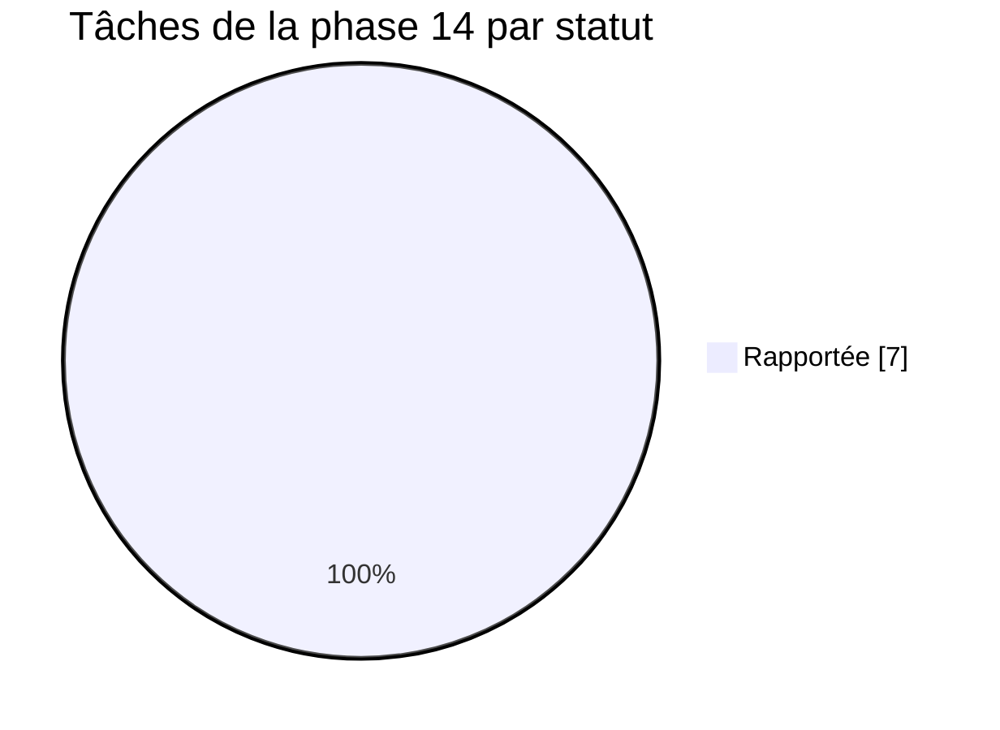
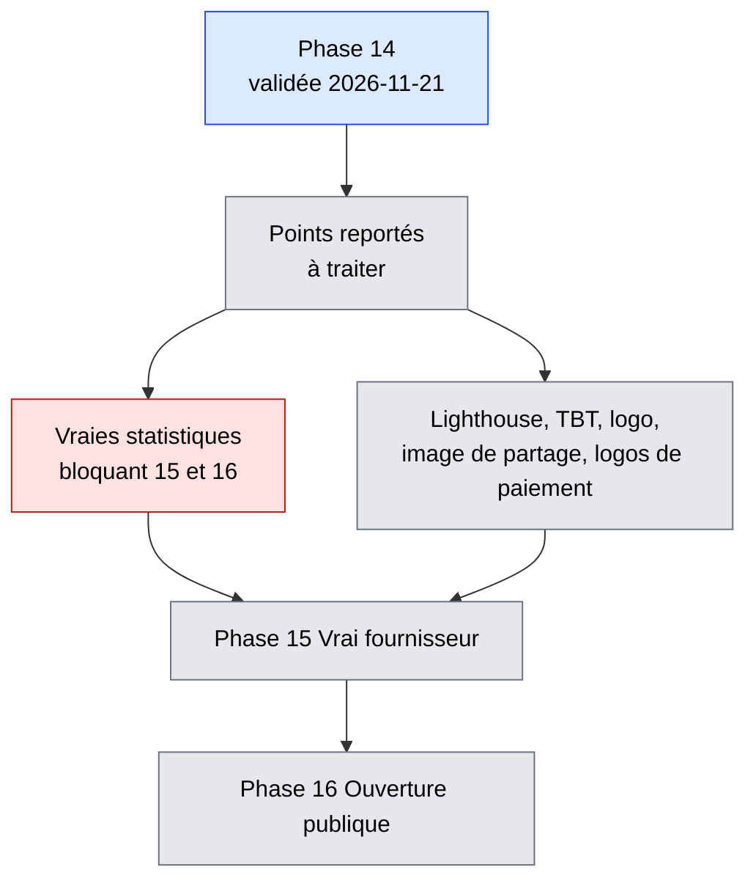

# Tableau de bord LyonPanel
Mis à jour le 2026-11-22. Phases 0 à 12 et 14 validées. Phase 13 (mise en ligne de test) laissée de côté, non validée. Chiffres lus dans les comptes-rendus des phases 1 à 14.

**En 5 secondes :** la phase 14 (accueil et SEO) est validée depuis le 2026-11-21 (PR 40). Aucune phase n'est en attente de validation. Prochaine étape : phase 15 (vrai fournisseur). Points reportés à traiter avant les phases 15 et 16 : vraies statistiques à la place de `PLACEHOLDER_STATS` (bloquant), Lighthouse non mesuré, TBT d'environ 1,2 s, couleur du logo, `public/og/default.png`, nettoyage des logos de paiement. Rien ne bloque aujourd'hui.

## 1. Avancement des phases
Bleu : validée. Gris : à faire ou laissée de côté. Dates réelles : phases 0 et 1 le 2026-11-07, phase 2 le 2026-11-08, phase 3 le 2026-11-09, phases 4 à 7 le 2026-11-10, phase 8 le 2026-11-11, phases 9 et 10 le 2026-11-16, phase 11 le 2026-11-17, phases 12 et 14 le 2026-11-21. Phase 13 : non faite (laissée de côté le 2026-11-21).

```mermaid
flowchart LR
  P0["Phase 0 Socle<br/>validée<br/>2026-11-07"] --> P1["Phase 1 Base de données<br/>validée<br/>2026-11-07"]
  P1 --> P2["Phase 2 Design system<br/>validée<br/>2026-11-08"]
  P2 --> P3["Phase 3 Comptes<br/>validée<br/>2026-11-09"]
  P3 --> P4["Phase 4 Prix et catalogue<br/>validée<br/>2026-11-10"]
  P4 --> P5["Phase 5 Recharge SasPay<br/>validée<br/>2026-11-10"]
  P5 --> P6["Phase 6 Commande<br/>validée<br/>2026-11-10"]
  P6 --> P7["Phase 7 Suivi et alertes<br/>validée<br/>2026-11-10"]
  P7 --> P8["Phase 8 Espace client<br/>validée<br/>2026-11-11"]
  P8 --> P9["Phase 9 Support<br/>validée<br/>2026-11-16"]
  P9 --> P10["Phase 10 Parrainage<br/>validée<br/>2026-11-16"]
  P10 --> P11["Phase 11 Admin 1<br/>validée<br/>2026-11-17"]
  P11 --> P12["Phase 12 Admin 2<br/>validée<br/>2026-11-21"]
  P12 --> P13["13 Mise en ligne de test<br/>laissée de côté"]
  P13 --> P14["Phase 14 Accueil et SEO<br/>validée<br/>2026-11-21"]
  P14 --> P15["15 Vrai fournisseur"]
  P15 --> P16["16 Ouverture publique"]
  classDef valide fill:#DBEAFE,stroke:#1D4ED8,color:#000
  classDef afaire fill:#E5E7EB,stroke:#6B7280,color:#000
  class P0,P1,P2,P3,P4,P5,P6,P7,P8,P9,P10,P11,P12,P14 valide
  class P13,P15,P16 afaire
```

## 2. Tâches de la phase 14 (tableau Kanban)
Toutes les tâches de la phase 14 sont rapportées, la phase est validée.

```mermaid
flowchart LR
  subgraph A["À faire"]
    direction TB
    a0["aucune"]
  end
  subgraph B["Tests écrits"]
    direction TB
    b0["aucune"]
  end
  subgraph C["Codée"]
    direction TB
    c0["aucune"]
  end
  subgraph D["Contrôles"]
    direction TB
    d0["aucune"]
  end
  subgraph E["À corriger"]
    direction TB
    e0["aucune"]
  end
  subgraph F["Acceptée"]
    direction TB
    f0["aucune"]
  end
  subgraph G["Rapportée"]
    direction TB
    g1["14.1 Prototypes"]
    g2["14.2 Accueil final"]
    g3["14.3 Pages réseaux"]
    g4["14.4 FAQ et contact"]
    g5["14.5 SEO technique"]
    g6["14.6 Test des balises"]
    g7["14.7 Durcissements et rapport"]
  end
  A --> B --> C --> D --> E --> F --> G
  classDef fait fill:#DBEAFE,stroke:#1D4ED8,color:#000
  classDef vide fill:#F3F4F6,stroke:#9CA3AF,color:#6B7280
  class g1,g2,g3,g4,g5,g6,g7 fait
  class a0,b0,c0,d0,e0,f0 vide
```

## 3. Répartition des tâches de la phase 14

## 4. Qui fait quoi maintenant
Plus aucun agent actif. La phase 14 est validée. Prochaine phase : 15 (vrai fournisseur), à ouvrir dans une nouvelle session après discussion avec le propriétaire. Les points reportés de la phase 14 sont listés dans son bilan.

## 5. Santé du projet
| Phase | Tests écrits | Tests verts | Couverture modules d'argent | Corrections demandées par les contrôles |
|---|---|---|---|---|
| 0 | 29 (28 Vitest + 1 Playwright) | 29 | sans objet | 2 correctifs après audit sécurité |
| 1 | 253 (225 base + 28 Vitest) | 253 | un test nommé par cas d'argent, pas de pourcentage | 2 failles moyennes, 1 fuite de colonnes, 1 paiement failed, tous corrigés |
| 2 | 270 (247 Vitest + 23 Playwright) | 270 | sans objet (aucun module d'argent) | 2 verdicts À CORRIGER (relecture, QA), corrigés |
| 3 | 543 (488 Vitest + 55 Playwright) | 543 (tests de base non relancés) | sans objet (aucun module d'argent) | sécurité : 2 passes À CORRIGER puis acceptée avec réserves ; QA : plusieurs passes, 2 points importants alors en correction |
| 4 | 1 048 Vitest + 13 Playwright (catalogue) + 278 base | 1 048 Vitest, 13 Playwright, 273 base (5 échecs : stockage de fichiers, conteneur arrêté) | calcul des prix testé (pas de pourcentage mesuré dans les comptes-rendus) | sécurité : 2 remarques corrigées ; QA : 1 passe À CORRIGER légèrement, corrigée |
| 5 | 1 124 Vitest + 10 Playwright + 373 base | 1 124 Vitest, 10 Playwright, 373 base (1 échec isolé de fabrique de test relancé vert) | un test nommé par cas d'argent (doublon, 3 envois, montant différent, panne SasPay), pas de pourcentage mesuré | relecture : 2 passes, sécurité : 2 passes (2 points moyens corrigés), QA : 2 passes (4 défauts corrigés) |
| 6 | 1 252 Vitest + 6 Playwright + 473 base ou plus | 1 252 Vitest, 6 Playwright, base : 1 échec connu sans lien (vrai compte dans la base locale) | pas 100 % strict : `place-order.ts` 97,5 % des lignes, `submit-to-provider.ts` aussi sous 100 % | relecture, QA et sécurité : 2 passes chacune ; 5 failles Basses au 1er passage, 3 corrigées, 2 reportées en phase 7 |
| 7 | 1 313 Vitest + 2 Playwright + 493 base | 1 313 Vitest, 2 Playwright, 493 base | non relancée, aucune fonction d'argent modifiée | relecture 2 passes ; QA et sécurité acceptées ; 2 failles Basses acceptées |
| 8 | 1 334 Vitest + 8 Playwright + base 597 sur 598 | 1 334 Vitest, 8 Playwright, base : 1 échec corrigé (`orders-sync`, commandes de test résiduelles), fichier 15 sur 15 | non relancée, aucune fonction d'argent modifiée | relecture 2 passes ; sécurité 2 passes (1 moyenne et 1 basse corrigées) ; QA 2 passes (3 importants et 6 mineurs traités) |
| 9 | 1 517 Vitest (phase 8 : 1 334) | 1 517 Vitest ; base et navigateur non relancés en total | non relancée, aucune fonction d'argent modifiée | relecture acceptée ; QA 4 passes (acceptée au 4e) ; sécurité 3 passes (acceptée au 3e) |
| 10 | 1 545 Vitest + 27 base (parrainage) + 5 Playwright | 1 545 Vitest, 27 base, 5 Playwright (clés Turnstile de test) | non relancée ; bonus et remise testés (seuil 49 999 / 50 000, un seul bonus) | sécurité acceptée (4 points bas) ; relecture et QA À CORRIGER puis corrigées, non re-contrôlées par les agents |
| 11 | 1 670 Vitest + 1 014 base (environ 283 tests écrits en 11.1, plus ceux des correctifs) + 17 Playwright d'accès écrits | 1 670 Vitest, 1 014 base ; Playwright non relancés dans ce lot | non relancée ; la dette, l'annulation de bonus et la recharge sur dette sont testées (un seul retrait même avec 5 annulations simultanées) | sécurité : 1 Haute, 4 Moyennes, 5 Basses puis ACCEPTÉ ; relecture 2 passes À CORRIGER, corrigées sans 3e passe ; QA 2 passes À CORRIGER, corrigées sans 3e passe visuelle |
| 12 | 1 843 Vitest + 308 base de sécurité + 25 Playwright (accès admin) | 1 843 Vitest, 308 base de sécurité, 25 Playwright | non relancée ; remboursements cumulés (10 simultanés, jamais plus que payé) et rejeu testés | sécurité ACCEPTÉ (3 remarques : 2 Basses, 1 Moyenne hors phase) ; relecture et QA À CORRIGER puis corrigées, non re-contrôlées par les agents |
| 14 | 2 146 Vitest + 24 Playwright (balises SEO) | 2 146 Vitest, 24 Playwright ; types, lint (0 erreur) et build OK ; CI à lire sur la PR | sans objet (aucun module d'argent) | relecture et QA ACCEPTÉ ; sécurité ACCEPTÉ (2 remarques basses, corrigées) |

Lire chaque ligne comme « état de la phase », pas comme un cumul. Phase 4 : le total Vitest (1 048) compte aussi les tests des phases précédentes ; les 278 tests de base incluent ceux de la phase 1. Les 13 tests Playwright datent d'avant la dernière retouche de redirection. Phase 11 : 1 670 et 1 014 sont les totaux du dernier passage, pas seulement les tests de la phase.

Performance de la démo (LCP médian, téléphone lent, build de production) : 5,85 s avant, 2,37 s après (phase 2). Temps de chargement de l'espace client non mesuré (phase 8). Écrans admin (phase 11, build de production, téléphone lent) : environ 0,5 à 1,3 s, connexion environ 2,5 à 3 s.

```mermaid
xychart-beta
  title "Tests Vitest par phase (écrits puis verts)"
  x-axis ["Phase 0", "Phase 1", "Phase 2", "Phase 3", "Phase 4", "Phase 5", "Phase 6", "Phase 7", "Phase 8", "Phase 9", "Phase 10", "Phase 11", "Phase 12", "Phase 14"]
  y-axis "Nombre de tests" 0 --> 2500
  bar [29, 253, 270, 543, 1048, 1124, 1252, 1313, 1334, 1517, 1545, 1670, 1843, 2146]
  bar [29, 253, 270, 543, 1048, 1124, 1252, 1313, 1334, 1517, 1545, 1670, 1843, 2146]
```

Première barre : tests écrits. Deuxième barre : tests verts. Phases 4 à 14 (sauf 13, non faite) : Vitest seulement (1 048, 1 124, 1 252, 1 313, 1 334, 1 517, 1 545, 1 670, 1 843 puis 2 146 verts, cumulés) ; les autres phases comptent aussi les tests de base et de navigateur.

## 6. Carte du code
La carte graphify (`graphify-out/graph.html`) n'a **pas été relancée** pour les phases 11, 12 et 14. À relancer (`graphify update .`) si tu veux une carte à jour.
