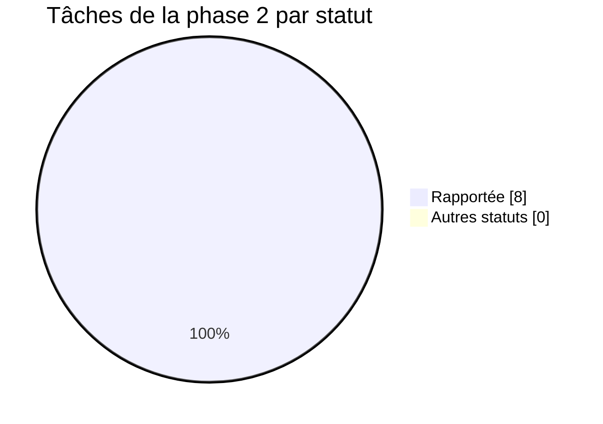
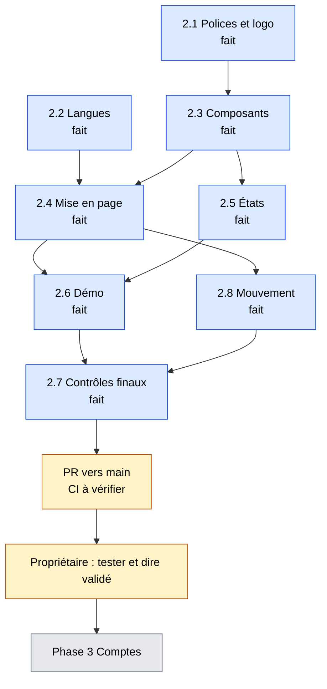

# Tableau de bord LyonPanel
Mis à jour le 2026-11-07 (fin de la phase 2). Chiffres lus dans les comptes-rendus des phases 1 et 2.

**En 5 secondes :** les phases 0 et 1 sont validées. La phase 2 (design system) est faite, en attente de ton « validé ». Points ouverts : longues tâches et TBT non améliorés, vrais logos à fournir, CI GitHub pas encore passée sur la PR. Ensuite : phase 3, comptes.

## 1. Avancement des phases
Bleu : validée. Jaune : faite, en attente de validation. Gris : à faire. Seules les phases 0, 1 et 2 ont une date réelle (2026-11-07).

```mermaid
flowchart LR
  P0["Phase 0 Socle<br/>validée<br/>2026-11-07"] --> P1["Phase 1 Base de données<br/>validée<br/>2026-11-07"]
  P1 --> P2["Phase 2 Design system<br/>faite, en attente<br/>2026-11-07"]
  P2 --> P3["3 Comptes"]
  P3 --> P4["4 Prix et catalogue"]
  P4 --> P5["5 Recharge SasPay"]
  P5 --> P6["6 Commande"]
  P6 --> P7["7 Suivi et alertes"]
  P7 --> P8["8 Espace client"]
  P8 --> P9["9 Support"]
  P9 --> P10["10 Parrainage"]
  P10 --> P11["11 Admin 1"]
  P11 --> P12["12 Admin 2"]
  P12 --> P13["13 Mise en ligne de test"]
  P13 --> P14["14 Accueil et SEO"]
  P14 --> P15["15 Vrai JAP"]
  P15 --> P16["16 Ouverture publique"]
  classDef valide fill:#DBEAFE,stroke:#1D4ED8,color:#000
  classDef enattente fill:#FEF3C7,stroke:#B45309,color:#000
  classDef afaire fill:#E5E7EB,stroke:#6B7280,color:#000
  class P0,P1 valide
  class P2 enattente
  class P3,P4,P5,P6,P7,P8,P9,P10,P11,P12,P13,P14,P15,P16 afaire
```

## 2. Tâches de la phase 2 (tableau Kanban)

```mermaid
flowchart LR
  subgraph A["À faire"]
    direction TB
    a0["aucune"]
  end
  subgraph B["Tests écrits"]
    direction TB
    b0["aucune"]
  end
  subgraph C["Codée"]
    direction TB
    c0["aucune"]
  end
  subgraph D["Contrôles"]
    direction TB
    d0["aucune"]
  end
  subgraph E["À corriger"]
    direction TB
    e0["aucune"]
  end
  subgraph F["Acceptée"]
    direction TB
    f0["aucune"]
  end
  subgraph G["Rapportée"]
    direction TB
    g1["2.1 Variables et polices"]
    g2["2.2 Langues et cookies"]
    g3["2.3 Composants"]
    g4["2.4 Mise en page"]
    g5["2.5 États"]
    g6["2.6 Démo"]
    g7["2.7 Contrôles finaux"]
    g8["2.8 Mouvement"]
  end
  A --> B --> C --> D --> E --> F --> G
  classDef fait fill:#DBEAFE,stroke:#1D4ED8,color:#000
  classDef vide fill:#F3F4F6,stroke:#9CA3AF,color:#6B7280
  class g1,g2,g3,g4,g5,g6,g7,g8 fait
  class a0,b0,c0,d0,e0,f0 vide
```

## 3. Répartition des tâches de la phase 2

## 4. Qui fait quoi maintenant
Aucun agent n'est actif. Reste : PR et CI (chef de projet), puis le propriétaire.

## 5. Santé du projet
| Phase | Tests écrits | Tests verts | Couverture modules d'argent | Corrections demandées par les contrôles |
|---|---|---|---|---|
| 0 | 29 (28 Vitest + 1 Playwright) | 29 | sans objet | 2 correctifs après audit sécurité |
| 1 | 253 (225 base + 28 Vitest) | 253 | un test nommé par cas d'argent, pas de pourcentage | 2 failles moyennes, 1 fuite de colonnes, 1 paiement failed, tous corrigés |
| 2 | 270 (247 Vitest + 23 Playwright) | 270 | sans objet (aucun module d'argent) | 2 verdicts À CORRIGER (relecture, QA), corrigés |

Les chiffres de la phase 2 sont ceux des vérifications de fin de phase. Les 247 Vitest de la phase 2 incluent les tests des phases précédentes. Le total 270 additionne donc des suites qui se chevauchent avec la phase 0 : lire la ligne comme « état de la phase 2 », pas comme un cumul.

Performance de la démo (LCP médian, téléphone lent, build de production) : 5,85 s avant, 2,37 s après.

```mermaid
xychart-beta
  title "Tests par phase"
  x-axis ["Phase 0", "Phase 1", "Phase 2"]
  y-axis "Nombre de tests" 0 --> 300
  bar [29, 253, 270]
  bar [29, 253, 270]
```

Première barre : tests écrits. Deuxième barre : tests verts. Phase 1 : tests de base de données surtout. Phase 2 : Vitest et Playwright.
